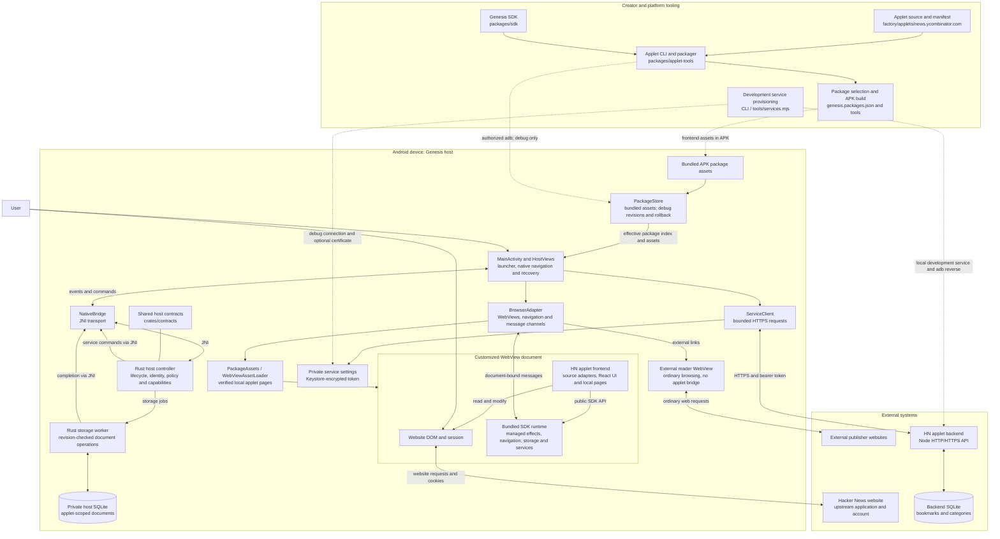

# Genesis current system architecture

This diagram describes the code selected in the repository on 30 October 2026. Solid arrows show runtime interactions or data flow; dotted arrows show build, provisioning, or development-only paths. The Hacker News (HN) applet is the only applet selected for the APK in `genesis.packages.json`. X and YouTube are inactive prototypes.

The SDK and Android exchange messages through a document-bound channel. Android passes host events through JNI to the Rust controller, which returns commands for Android to execute. The host validates identities and declared capabilities; it does not implement HN-specific backend operations. Completion messages return through the host and are checked against the live document before delivery.

The HN frontend uses the optional host document store for Post drafts and public account coordination. Its bookmarks and categories are authoritative in the separate HN backend database. Website cookies remain part of the WebView session; the backend uses a separate service credential. The backend is not bundled into or executed by the Android app.

Debug builds can import validated applet revisions and service settings over authorized adb. Release builds use bundled packages and do not consume those development imports. The preserved `crates/page-runtime` Wasm code and Kotlin starter are inactive; production publisher trust and independent distribution are not implemented.

Sources: [architecture index](../../../.architecture/README.md), [platform](../../../.architecture/platform.md), [browser runtime](../../../.architecture/browser-runtime.md), [services and data](../../../.architecture/services-and-data.md), [HN applet](../../../.architecture/hacker-news.md), and [package selection](../../../genesis.packages.json). No current phase-4 operating guide is present in `.docs`.
