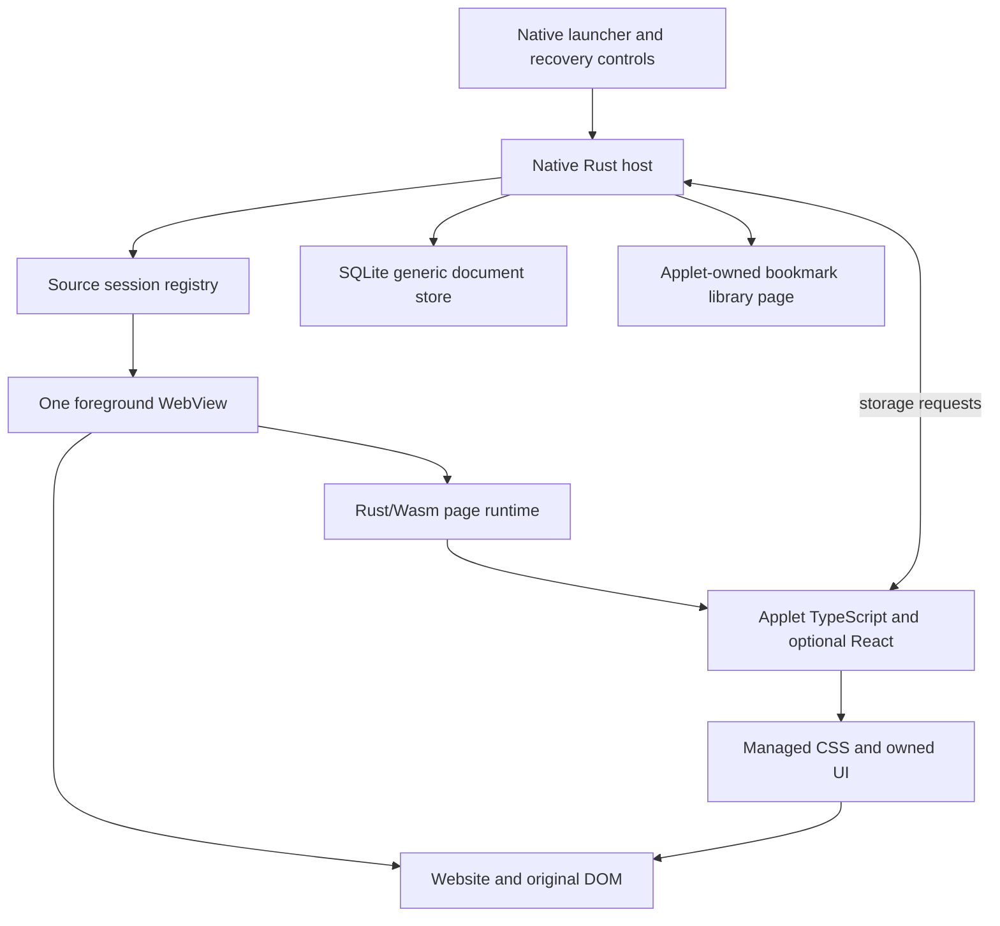

# Genesis MVP implementation plan

Created 27 October 2026, Asia/Kolkata. Scope: the Genesis monorepo, its Android application and the YouTube/X applets. Status: implementation specification, not implemented or device-qualified.

## 1. Instructions for the implementing model

Implement the decisions in this plan. Do not reopen the framework, language, storage or directory choices during routine work. Complete the delivery stages in order. When a platform qualification gate fails, report its exact evidence and follow the specified fallback decision. Do not replace a failing capability with a mock and mark the stage complete.

Read these companion plans before changing code:

| Plan | Authority |
| --- | --- |
| [Android and build](150238-genesis-android-build-plan.md) | Android Studio project, versions, build pipeline, JNI and browser lifecycle |
| [Runtime and SDK](150238-genesis-runtime-sdk-plan.md) | Manifest, injection, protocol, source identities, managed effects and storage |
| [YouTube and X applets](150238-genesis-youtube-x-applets-plan.md) | Website-specific behavior, selectors, records and UI |
| [Delivery and verification](150238-genesis-delivery-verification-plan.md) | Ordered tasks, acceptance evidence and handoff rules |

This set replaces the open alternatives in the [live customization research](../../.research/live-dom-customization/README.md) for this MVP. Root and nested `AGENTS.md` instructions still apply. The current instruction prohibits creating automated test files without an explicit request for test coverage. This plan provides acceptance scenarios; it does not override that instruction.

## 2. User-visible scope

The user opens `android/` in Android Studio, performs documented one-time toolchain setup, selects a device, and presses Run. Genesis opens a native launcher listing two bundled applets.

- YouTube opens the ordinary mobile website with Shorts navigation, shelves and identifiable Shorts cards suppressed. Direct and internal Shorts routes are blocked. Regular videos use the original player.
- X opens the ordinary website with a separate Genesis Save control on supported posts. The user can save a post into zero, one or several categories, manage categories, and browse a local library. Genesis never calls X's bookmark action.
- Native Home, Back, Reload and recovery controls remain available. An applet failure is visible, and the user can disable customization and open the ordinary site.
- A creator edits code under `applets/`, rebuilds through Android Studio, and sees the updated customization without changing the platform. Installing an updated APK must preserve local bookmarks.

Defaults are local device storage, one Genesis profile named `local`, and no synchronization. Bookmarks are shared across X account switches within that Genesis profile. Display this fact in the library settings; do not infer an X account identity that the runtime cannot reliably obtain.

## 3. Fixed architecture

| Decision | Selected implementation |
| --- | --- |
| Browser | Android System WebView with AndroidX WebKit 1.18.0 |
| Android host | Native Rust controller behind a narrow Java Activity/WebView/JNI adapter |
| Page runtime | Rust/Wasm in an isolated execution world, compiled with wasm-bindgen |
| Creator language | TypeScript and CSS; React only where useful |
| YouTube UI library | None. Plain TypeScript rules and CSS |
| X UI library | React/React DOM for save dialog and bookmark library |
| Rendering | Preserve the running source page; mount new UI into owned containers |
| Local library | Applet-owned local HTML page in the single browser slot, served by WebViewAssetLoader |
| Persistence | Rust `rusqlite`, generic document storage with atomic compare-and-set batches |
| Bundler | esbuild, single IIFE for each injected entry; no external imports at runtime |
| Package manager | npm workspaces and one root package-lock.json |
| Creator distribution | Bundled applets rebuilt into the APK for MVP |
| Source model | An applet instance owns a map of named source sessions; no global current website singleton |
| MVP source budget | One live source WebView across the foreground app; other sessions retain definitions and last URLs |

Java contains platform plumbing and generic view rendering only. It must not contain YouTube URL rules, X selectors, category logic, persistence decisions or an independent app state machine. Rust owns these platform decisions, and applet TypeScript owns website customizations. Generated JavaScript/Wasm bindings and React remain necessary parts of the execution stack.



The local library uses the same browser slot, not a permanent second renderer. Switching between a source and a library, between applets, or between source IDs destroys the old WebView and creates a fresh one with the correct scripts. Retain the source's last committed URL. Cookies remain in the persistent WebView profile. Source back-stack entries and unsaved page state are not promised to survive this transition. Navigation within the same source uses its current WebView normally.

## 4. Repository design

```text
genesis/
  Cargo.toml                       # workspace
  Cargo.lock
  rust-toolchain.toml
  package.json                     # npm workspaces and commands
  package-lock.json
  tsconfig.base.json
  .nvmrc
  android/                         # open THIS directory in Android Studio
    settings.gradle.kts
    build.gradle.kts
    gradle.properties
    gradle/libs.versions.toml
    gradle/wrapper/
    gradlew
    gradlew.bat
    local.properties               # ignored, machine paths only
    app/
      build.gradle.kts
      src/main/AndroidManifest.xml
      src/main/java/app/nirvana/genesis/
        MainActivity.java
        NativeBridge.java
        BrowserAdapter.java
        HostViews.java
      src/main/res/
      build/generated/genesis/     # ignored generated assets and JNI libraries
    native/
      Cargo.toml
      src/lib.rs                   # JNI boundary
      src/controller.rs            # HostState and host events
      src/browser.rs               # generic browser commands
      src/sources.rs               # source sessions and view bindings
      src/packages.rs              # bundled package validation
      src/storage.rs               # generic SQLite document transactions
      src/recovery.rs
  crates/
    contracts/                     # pure Rust wire types, identities, errors
    page-runtime/                  # Rust/Wasm DOM and lifecycle implementation
  packages/
    sdk/                           # small TS facade over Rust exports
      src/{index,protocol,storage,source,ui}.ts
  applets/
    youtube.com/
      applet.json
      package.json
      tsconfig.json
      src/{main,targets,shorts,routes}.ts
      src/styles.css
    x.com/
      applet.json
      package.json
      tsconfig.json
      src/main.tsx
      src/library.tsx
      src/{targets,extract-post,post-url,repository,categories}.ts
      src/components/
      src/styles.css
      src/library.css
  tools/
    build.mjs                      # Node orchestration, no site behavior
    check-packages.mjs
  .plans/
  .research/
```

Keep Android-specific Rust under `android/native/`. Shared Rust contracts and page runtime belong in `crates/`. All YouTube/X selectors, feature rules, bookmark/category algorithms and custom UI belong in their respective `applets/` directories. Generic storage code must not know what a tweet or category is.

Start with three Rust crates: `genesis-contracts`, `genesis-page-runtime`, and `genesis-android`. Avoid one crate per file. Use focused modules inside those crates. Do not add a separate service, repository factory, dependency-injection framework or event bus where a struct and explicit method suffice.

## 5. Hybrid applets without premature multi-tab machinery

Every manifest uses `sources: [...]`, even when it has one source. Every source has an ID, start URL, origin allowlist and injected entry. A future hybrid package can declare `youtube` and `x`, import shared applet modules, and have its own aggregate UI and data namespace.

The host keys sessions by `(instanceId, sourceId)`. A live DOM handle is valid only inside its source's current document. The SDK exposes an asynchronous `sources.open(sourceId, url?)` operation; code must not assume that opening a source leaves the previous document alive. In the MVP it switches the one available view.

Reserve a versioned observation topic contract for later cross-source records. Do not implement a fake synchronous cross-tab DOM API. A later multi-view scheduler can replace the one-view budget while retaining source IDs, document identities, package format and storage namespaces. Concurrently fresh multi-source data remains future work and requires new lifecycle/resource evidence.

The host must accept multiple source definitions structurally and route a requested source by ID. This is the concrete extension point. It does not require shipping a third hybrid applet in this MVP.

## 6. Scope exclusions

Do not implement a Chromium fork, native UI reconstruction of entire websites, a DOM mirror, a custom virtual DOM, general server API integrations, cloud synchronization, a package marketplace, on-phone npm builds, arbitrary ZIP installation, or background automation. Do not port the Bonsai application wholesale.

Retain normal login and original media interaction where WebView supports them. Do not bypass embedded-browser authentication restrictions or assume that logging in through another browser establishes this WebView's session. Authentication is treated as ordinary browser-managed behavior. At the user's request, dedicated X sign-in and session-retention verification is deferred and is not a current implementation or release gate. This is a scope decision, not a claim that those checks passed.

## 7. Fixed choices versus empirical work

Architecture, module ownership, APIs, data semantics and build structure are fixed by this set. The exact live website selectors and provider compatibility still require inspection on the chosen device. No document can responsibly manufacture those facts.

If a selector fails, repair its applet target module. If required isolated-world Wasm loading fails, stop at the qualification gate with the exact CSP/provider result. Do not silently move the runtime to JavaScript, switch to page-world execution, relax origin rules, or start a browser fork.

## 8. Completion definition

The MVP is complete when Android Studio Run builds the project after one-time setup; both applets work on a physical Android device; the documented Shorts paths are blocked; categorized Genesis bookmarks persist independently of X; local library operations work offline; and native recovery handles a failed applet. The final delivery report must name unsupported routes, account flows and devices.

This planning task changes documents only. It does not create app source, install toolchains, create test files or claim that any stage has passed.

## Account ownership clarification

Users sign in to their own existing accounts directly in Genesis's source WebView. There is no shared Genesis-operated website account, agent account, credential service, or central authentication backend. The browser retains ordinary first-party cookies and website session storage in the application's persistent WebView profile. Genesis must not read, export, log, synchronize or ask the user to send credentials, session cookies or tokens. Do not clear browsing data when switching sources, returning Home, recreating a view or installing an APK update. Websites still control session expiry, reauthentication and embedded-browser access.

The WebView cookie profile is separate from Chrome and other browsers. A user's existing Chrome sign-in is not automatically inherited; sign in inside Genesis. This is browser-managed authentication, not an applet authentication API. Genesis's local applet data profile remains separate from website account identity.

A connected physical device is an empirical qualification requirement, not an authentication implementation dependency or a request to share an account. Implementation and emulator checks may proceed without one. Users may sign in privately during normal browser use. Dedicated real-account login and session-retention checks are deferred by the user and do not block the current work or stage progression. Do not request a device or account access for authentication verification unless the user reopens that work. Physical-device results for injection, media and recovery remain pending until run on physical hardware; those independent requirements are unchanged.
