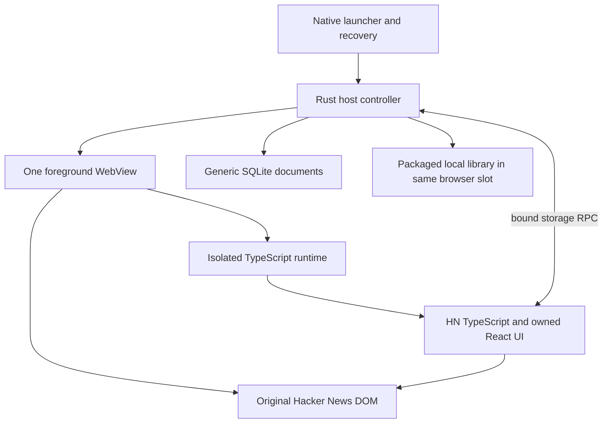

# Genesis MVP implementation plan

Architecture revision approved 28 October: all browser customization and the managed DOM runtime use TypeScript/JavaScript under `packages/sdk/` and `applets/`, with React for custom dialogs and local pages. Native Rust retains the controller, contracts and SQLite services. HN refuses Wasm compilation in its source realm, as recorded in the [historical qualification report](../../../.reports/phase-2/2026-10-28/162112-genesis-hn-wasm-qualification-report.md). The TS runtime passed [MVP-02 emulator qualification](../../../.reports/phase-2/2026-10-28/174427-genesis-hn-typescript-qualification-report.md); MVP-03 passed emulator verification. MVP-04 storage passed [Android emulator verification](../../../.reports/phase-2/2026-10-28/183914-genesis-mvp04-android-storage-verification-report.md); MVP-05 passed [Android Save verification](../../../.reports/phase-2/2026-10-29/095635-genesis-mvp05-android-save-verification-report.md); MVP-06 passed [category/library emulator verification](../../../.reports/phase-2/2026-10-29/110545-genesis-mvp06-library-verification-report.md). The working emulator prototype is the current delivery target. Physical-device qualification and device-specific performance gates are deferred to pre-release under the user's 29 October instruction; they do not block the emulator handoff. MVP-07 functional integration and the emulator handoff are verified in the [final report](../../../.reports/phase-2/2026-10-29/112349-genesis-mvp07-emulator-handoff-report.md).

Created 27 October 2026, Asia/Kolkata. Revised for the user's Hacker News prototype. Scope: the Android browser host, reusable runtime/SDK and one public Hacker News bookmarking applet. MVP-01 is verified on the emulator. MVP-02 platform code is implemented; the approved TS runtime is verified on the emulator. The HN package is the new qualification target; no prior YouTube/X result verifies it.

## 1. Authority and execution

Read root/nested `AGENTS.md`, Git status and these companion plans before implementation:

| Plan | Authority |
| --- | --- |
| [Android/build](150238-genesis-android-build-plan.md) | Toolchain, packaging, JNI and browser lifecycle |
| [Runtime/SDK](150238-genesis-runtime-sdk-plan.md) | Manifest, bindings, managed DOM APIs and generic storage |
| [Hacker News applet](150238-genesis-hacker-news-applet-plan.md) | Story extraction, bookmark/category records and UI |
| [Delivery/verification](150238-genesis-delivery-verification-plan.md) | Stage order, acceptance evidence and stop conditions |

Use the [continuation guide](../../../.docs/phase-2/2026-10-27/200113-genesis-hacker-news-mvp-guide.md) for bounded prompts. Implement one stage at a time and commit verified components using repository rules. Do not add/modify automated test files without explicit authorization. Existing tests and manual/build checks are allowed.

These five plans supersede the earlier two-applet product scope. Preserve `applets/youtube.com/` and `applets/x.com/` unchanged as inactive workspaces. They are excluded from the bundled package index and current prototype acceptance. Do not resume their features or migrate/delete their data. Historical reports remain historical evidence.

## 2. User-visible scope

Android Studio Run opens a native launcher with one applet, `Hacker News with Genesis bookmarks`. Its source is `https://news.ycombinator.com/`; its package ID is `hn-bookmarks`.

- Browse HN's original public story lists and story discussion pages without signing in.
- Add a separate `Save to Genesis` control to supported story rows. Save to zero, one or several local categories; edit or remove a saved item explicitly.
- Create, rename and delete categories. Browse All, Uncategorized and category filters in a packaged local library that works offline for already saved metadata.
- Open a saved HN discussion from the library. Preserve HN title links, pagination, comment trees, voting and favorite controls; never invoke account actions to save a Genesis bookmark.
- Keep native Home, Back, Reload, library access and recovery available. An unsupported provider or failed applet remains explicit and offers ordinary browsing.

All Genesis data is local to profile `local` and this app installation. The prototype requires no website account, account detector, cloud service or HN API client. It stores bounded text/URLs, not full articles, comment trees or downloaded media.

## 3. Fixed architecture

| Component | Selected implementation |
| --- | --- |
| Browser | Android System WebView and AndroidX WebKit 1.18.0 |
| Host/controller | Rust under `android/native/`, narrow Java Activity/WebView/JNI adapters |
| Page runtime | TypeScript/JavaScript in the isolated `genesis.v1` execution world |
| Creator code | TypeScript/CSS; plain DOM for per-story buttons, React for one dialog and the library |
| Rendering | Preserve the live website; use owned styles and Shadow DOM hosts |
| Storage | Native Rust `rusqlite`, generic document namespaces and atomic CAS batches |
| Local page | WebViewAssetLoader, declared immutable package assets, no development server |
| Build | npm workspaces, self-contained esbuild TS/JS IIFEs, Gradle-generated assets/JNI libraries |
| Resource budget | One live WebView; source/local-page switches recreate the view |

Java handles generic platform plumbing. Rust owns host state, binding and storage policy. HN selectors, URL normalization, item extraction, category algorithms and custom UI belong in the HN applet. Native SQL must not know what an HN story/category is.

## 4. Repository ownership and reuse

| Location | Responsibility |
| --- | --- |
| `android/app/` | Existing Java host, resources, Gradle-generated assets and JNI registration |
| `android/native/src/` | Controller, source registry, package validation/JNI and generic storage worker |
| `crates/contracts/` | Shared identities, envelopes and typed errors |
| `crates/page-runtime/` | Preserved inactive Wasm qualification code; not bundled or extended |
| `packages/sdk/` | Managed DOM runtime and creator-facing TypeScript SDK |
| `applets/news.ycombinator.com/` | HN manifest, qualification entry/inspector; future targets, extraction, repository, categories, Save dialog and library |
| `tools/` | Existing build orchestration and bundled package selection/validation |
| `applets/youtube.com/`, `applets/x.com/` | Preserved inactive code; no current delivery obligations |

Reuse MVP-01/02's workspace/toolchain locks, native Rust build, ABI outputs, launcher, nonce handshake, source/page loader, qualification effect lifecycle, inspector and recovery paths. Do not replace the running browser or rebuild these components. The active HN entries now implement bookmarking and the local library. No placeholder persistence may be presented as durable storage.

## 5. Source and document lifecycle

Keep source definitions as an array, keyed by `(instanceId, sourceId)`, even with one bundled HN source named `primary`. Source DOM handles are valid only for the current document. Source/local-page transitions retire the old binding, destroy its view and recreate destination-specific scripts. Retain the last committed URL; history, forms and DOM handles are not restoration guarantees.

Multiple source definitions remain a structural extension point in the generic host. Do not ship a hybrid applet, simultaneous renderers, cross-tab DOM API or background automation for this prototype.

## 6. Scope exclusions

No YouTube filtering, X integration, HN comment bookmarking, account login/retention experiments, HN favorites synchronization, voting automation, API feed reconstruction, cloud sync, marketplace, arbitrary package installation or browser fork. Jobs, user profiles, search results and individual comment permalinks are outside required bookmark coverage. Unsupported layouts remain visible and receive no guessed Save identity.

Existing native fullscreen/media support is preserved, but media/playback gates are not requirements of this text-based HN prototype. Do not require signing into any website to finish it.

## 7. Qualification and stop conditions

The selected world-aware injection, bridge and navigation APIs remain required. The original emulator provider lacked `JS_INJECTION_IN_FRAME_AND_WORLD` and `NAVIGATION_LISTENER`; its official update resolved those missing APIs, as recorded above. Switching to HN removes login dependence; it does not supply missing browser APIs. Check actual provider flags, then prove the HN document/realm contract before MVP-03. On 28 October the user authorized progression after emulator qualification; physical-device repetition remains required at pre-release. Do not change worlds, relax origins, simulate runtime success or change engines to bypass a failed gate.

Public HTML inspection supports candidate HN selectors only. Actual Android isolated-world startup, twenty fresh-document cycles, local-page activation and native recovery require HN evidence, now recorded in the linked HN qualification reports. Label emulator and physical-device results separately.

## 8. Completion definition

The emulator prototype is ready when the documented build runs; HN story Save/edit/remove and category operations work on the named emulator; the offline local library and update/restart persistence pass; original HN navigation remains usable; and native recovery works. Every non-deferred gate must have evidence. Physical-device repetition, device-specific performance thresholds and release qualification remain pre-release tasks. No successful login experiment is required.

## 9. Browser and session contract

This section is authoritative across all five plans. HN bookmarking uses public pages and native local storage. Authentication is outside this prototype. Do not request website credentials or account/device access for login verification.

| State | Owner and lifetime |
| --- | --- |
| Website cookies/storage | WebView's existing persistent default profile and the website; keep enabled and preserve across view recreation. No credential bridge or Chrome-cookie import. |
| Tab state | The live view owns DOM, history and `sessionStorage`; replacement may discard them. |
| Native `SourceSession` / `SessionSnapshot` | Navigation definitions, URLs and lifecycle metadata; never a credential store. |
| Genesis bookmarks | SQLite namespace `(local, hn-bookmarks)`, independent of website cookies or account identity. |

Home, ordinary-site recovery, source/library switches and renderer recovery must not clear browser data or applet data. Install updates with the same application ID and compatible signing; uninstall/app-data clearing removes local persistence. Preserve earlier applet data if present. Session expiry follows browser/site rules. Future authentication work needs its own scope; it is not a prerequisite for this prototype.
