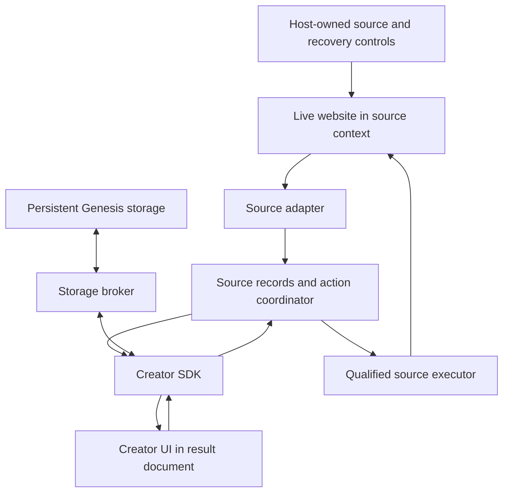

# A browser runtime for website UI layers

Superseded defaults: start with the later [live website customization document set](../live-dom-customization/README.md). It adopts incremental same-document customization, a Rust runtime and JS/TS creator code. This document retains the earlier projection proposal and its persistent-data analysis.

Date: 27 October 2026, Asia/Kolkata. Status: proposal for discussion. No runtime implementation, device test or performance benchmark was performed. API examples describe contracts to build, not existing Genesis functions.

This document answers the questions raised by the [runtime walkthrough](../rust-monorepo/2026-10-26-runtime-walkthrough.md). It builds on the [architecture review](../architecture-review/2026-10-27-architecture-and-build-roadmap.md) and [creator framework options](2026-10-26-architecture-options.md). It adds a persistent application-data contract and separates browser hosting, implementation language and UI ownership. It predates the user's approval of JS/TS creator code and the change to incremental customization as the default.

## Recommendation

Keep the custom UI in a browser. Build a framework that combines observed website records with applet-owned data, then renders ordinary browser UI. Keep source extraction, source actions, persistent storage and rendering as separate contracts.

For the current Android target, start with one source WebView and one result WebView, bounded source records and a small host. Do not require a native DOM mirror. Keep a host-owned control for revealing the original page and recovering a failed applet.

If all Genesis behavior must remain Rust, use Rust/Wasm inside the browser and a narrow JNI adapter for the native Rust host. If that language constraint becomes flexible, a Kotlin host with JavaScript or TypeScript source agents and applets is a simpler candidate to qualify. Changing language is a product/maintenance decision, not a prerequisite for browser rendering. An extension is a useful desktop prototype; Electron is a desktop host option. Neither demonstrates Android compatibility.

The most revealing first applet is a video list with Genesis bookmarks. It tests observation, custom layout, persistent writes and reopening saved content after the original DOM target disappears.

## 1. Does DOM transformation support every view?

Separate what the UI can draw from what the source can supply.

Creators can implement lists, grids, boards, dashboards, forms and custom interactions using browser APIs. Rust/Wasm bindings can create and update DOM elements, as the [web-sys DOM example](https://wasm-bindgen.github.io/wasm-bindgen/examples/dom.html) demonstrates. Supporting a particular editor, rendering library or accessibility behavior still requires integration and testing.

The source adapter cannot provide arbitrary information or behavior merely because the creator can draw a control for it. A useful model is:

```text
Custom view = render(observed website records,
                     persistent Genesis data,
                     temporary UI state)

Website operation -> qualified source action
Genesis feature   -> Genesis storage or service
```

| Requested view or feature | What it needs | Main limit |
| --- | --- | --- |
| Compact list or channel grouping | Observed titles, links and channel identity | Only content the adapter has actually observed |
| Bookmarks, tags or personal notes | Genesis-owned persistent data | Requires storage semantics beyond DOM extraction |
| Saved-item screen while offline | Stored URLs and metadata | Saving metadata does not save playable video or authenticated content |
| Full account history or unseen search results | Additional source loading or another explicitly supported integration | A snapshot cannot invent data absent from the observed source |
| Playback inside an arbitrary new card | Qualified media integration | Copying a DOM node or media URL does not reproduce the original player/session |
| Arbitrary source control | A supported action and observable result | Synthetic events may lack required user interaction privileges |

DOM structure is one observation channel. Input properties, route changes and media state may need their own listeners. Canvas pixels do not provide the site's semantic object model. Ordinary DOM queries do not traverse every shadow root or cross-origin frame. Browser extensions can have additional access through declared permissions, but an adapter must qualify that access for the chosen host. [Same-origin policy](https://developer.mozilla.org/en-US/docs/Web/Security/Defenses/Same-origin_policy), [content-script capabilities](https://developer.chrome.com/docs/extensions/develop/concepts/content-scripts).

There are also two different meanings of "change the view":

1. Modify source CSS or add controls inside the source page. This suits small changes and preserves direct interaction with existing controls, but the website can rerender the same DOM.
2. Read source records and render a separate applet document. This gives the creator ownership of markup and layout, but source behavior must be invoked explicitly.

Use the second approach as the general applet contract. Keep source-page customization as a narrower mode. A separate layout does not carry the original event handlers, focus behavior or media objects across documents.

## 2. Bookmarks turn the layer into an application

A Genesis bookmark can exist even if the underlying website has no bookmarking feature. Genesis owns the record and its behavior. Adding it does not change the website's database.

Keep four lifetimes explicit:

| State | Owner | Example | Lifetime |
| --- | --- | --- | --- |
| Website state | Website | Subscription or playback position | Website-defined |
| Observed source cache | Genesis source runtime | Current visible cards and live targets | Expires with freshness/context |
| Persistent applet data | Genesis storage | Bookmarks, notes, preferences | Survives source recreation and compatible applet updates |
| Temporary UI state | Applet renderer | Open menu or current selection | Usually ends when the applet closes |

An illustrative bookmark record:

```json
{
  "id": "youtube:video:abc123",
  "canonical_url": "https://www.youtube.com/watch?v=abc123",
  "title_at_save": "Building a tiny cabin",
  "channel_at_save": "Forest Workshop",
  "saved_at": "2026-10-27T08:00:00Z",
  "tags": ["woodworking"],
  "note": "Try this joint"
}
```

Store it in a namespace derived from the trusted applet installation and Genesis profile. For account-specific records, include an explicit source-account binding. If account identity is unavailable, choose and disclose a device/profile scope instead of pretending the bookmark is account-bound.

The stable content key and canonical URL survive navigation. A source node ID does not. Never use a saved node ID as a durable bookmark target.

The Save flow writes to Genesis storage and reports success after the storage transaction completes. It requires no website action. Repeating Save should upsert the same stable key. A storage failure leaves a visible unsaved/error state. Reading the saved list should work without a source page, using metadata clearly marked as saved rather than current.

The Open flow asks the host to navigate an approved source to the canonical URL. It checks the URL scheme, allowed destination, profile and current source binding. After navigation, the adapter obtains fresh records and targets. Source records may update display metadata without overwriting the user's note or tags. Unavailable content remains a saved item with an explicit unavailable state.

### Storage backend and ownership

| Host | Candidate backend | Required boundary |
| --- | --- | --- |
| Browser extension | IndexedDB in an extension-owned context, or extension storage for small preferences | Source content scripts send storage requests to the extension broker |
| Android application | Host-owned SQLite behind a storage API | Applets cannot choose another applet's namespace |
| Early standalone applet experiment | IndexedDB at a stable applet-owned origin | Test origin stability, updates, quota failures and data clearing |

[IndexedDB](https://developer.mozilla.org/en-US/docs/Web/API/IndexedDB_API) supports transactional browser storage. The [extension storage API](https://developer.chrome.com/docs/extensions/reference/api/storage) provides persistent extension data and change notifications. Neither requires a custom cloud backend for local bookmarks.

Do not put durable Genesis records into the source website's localStorage or IndexedDB. In an extension content script, those web storage APIs refer to the host page's storage. Use an extension-owned context or the host broker. [Extension storage and cookies](https://developer.chrome.com/docs/extensions/develop/concepts/storage-and-cookies).

Every persistent store needs schema versions, transactional migrations, observable write failures, export and an explicit deletion policy. Package rollback must preserve a compatible data snapshot or refuse incompatible activation; restoring UI assets alone cannot reverse a migration. Different URL paths under one origin are not a storage isolation boundary. Arbitrary applet code sharing that origin can bypass an SDK namespace convention, so enforce separation through distinct qualified origins or host-only brokered storage. [Origin-based storage access](https://developer.mozilla.org/en-US/docs/Web/Security/Defenses/Same-origin_policy).

Browser storage also has quota and eviction behavior. Document what survives browser-data clearing, uninstall and device loss; provide export rather than equating local persistence with backup. [Storage quotas and eviction](https://developer.mozilla.org/en-US/docs/Web/API/Storage_API/Storage_quotas_and_eviction_criteria).

Cross-device sync and shared bookmarks are later Genesis services with their own identity, authorization, conflicts and deletion rules. They do not become features of the underlying website. Start with local writes; do not mix them with an offline queue of website actions whose eventual outcome may be uncertain.

## 3. WebAssembly and existing browser features work together

Wasm is a way to execute compiled code inside a browser. It does not replace the browser's DOM, layout, event loop, storage or network rules. Browser Wasm currently calls DOM APIs through bindings to JavaScript. [WebAssembly concepts](https://developer.mozilla.org/en-US/docs/WebAssembly/Guides/Concepts).

| Work | Browser facility | Possible implementation |
| --- | --- | --- |
| Observe loaded content | DOM queries, MutationObserver and specific event listeners | Rust/Wasm bindings or JavaScript |
| Render creator UI | DOM, CSS, browser layout and accessibility APIs | Rust UI framework or conventional web UI framework |
| Persist applet data | IndexedDB or brokered host storage | Same logical SDK contract for either language |
| Coordinate source/result contexts | Host messaging or extension messaging | Small host with bounded protocol |
| Heavy local computation | Worker and possibly Wasm | Add when a measured workload needs it |

Wasm helps reuse Rust types and algorithms and keeps application logic in the requested language. Its costs include bindings, module startup, package/toolchain complexity and target-specific loading. It does not guarantee faster DOM updates or isolate a blocked UI event loop. A source-side Wasm loader also needs qualification against the selected execution world's policy; CSP can restrict Wasm compilation. [CSP and Wasm execution](https://developer.mozilla.org/en-US/docs/Web/HTTP/Reference/Headers/Content-Security-Policy/script-src#unsafe_webassembly_execution).

If Rust is firm, retain Wasm and simplify the pipeline around it. If language is open, start with JavaScript/TypeScript for DOM observation and rendering, and add Rust/Wasm where reuse or profiling justifies it. This is an engineering recommendation, not a benchmark result.

## 4. JNI does not render the result UI

In the walkthrough, both source and result already render inside browser WebViews. JNI connects the native Rust controller to Android's managed WebView APIs. The browser messaging bridge and JNI are separate boundaries:

```text
Source agent -> WebView message -> Android host
                                     |
                                JNI only if
                            controller is native Rust
                                     |
Result applet <- WebView message <- Android host
```

JNI provides managed/native interoperability. Android's guidance recommends minimizing marshaling and the number of crossings. [JNI tips](https://developer.android.com/ndk/guides/jni-tips).

A Kotlin host can manage WebViews and receive browser messages without a Genesis-authored Rust/JNI layer. Rust/Wasm can still run in the page. This would change the earlier native Rust requirement, so it remains an alternative rather than the selected roadmap. AndroidX exposes document-start injection and origin-scoped messaging, subject to provider feature checks. [WebViewCompat](https://developer.android.com/reference/androidx/webkit/WebViewCompat).

### The two implementation approaches

Both approaches below use browser-rendered UI. The comparison concerns the host/controller and implementation language.

| Consideration | Native Rust controller plus JNI | Browser-centered logic plus a small platform host |
| --- | --- | --- |
| Strength | Shared native Rust state machines, host-owned coordination and storage | Shorter browser development loop and fewer language boundaries if JS/TS is allowed |
| Cost | Android ABI builds, JNI lifetimes, thread dispatch and browser/native messages | More lifecycle/recovery policy must remain in the host when browser code pauses or fails |
| Rendering | Existing WebView engine | Existing browser/WebView engine |
| Persistent data | Host database through explicit SDK | Extension-owned browser storage or a small host database broker |
| Portability | Pure Rust logic can be shared; each platform still needs an embedding adapter | Browser logic can be shared; host injection, permissions and background behavior differ |
| Failure recovery | Controller can remain outside a failed renderer if the host is healthy | Extension or platform host must retain recovery outside creator-owned execution |
| Performance expectation | Can move CPU work off the renderer; extra copies/crossings can cost time | Can avoid some native round trips; extraction/rendering can still block the browser |
| Best fit | Rust ownership is a requirement, or substantial native coordination is demonstrated | Fast validation when ordinary web tooling and a thinner host meet product needs |

Neither has a measured Genesis performance advantage yet. The native controller does not make source selectors more reliable, guarantee successful clicks or make two WebViews independent processes.

If "native approach" means drawing the creator UI with Android widgets, that is another independent choice:

| Consideration | Native Android UI | Browser UI |
| --- | --- | --- |
| Creator tools | Android components or a new Genesis rendering contract | Existing HTML/CSS and Rust/Wasm or JavaScript UI libraries |
| Platform integration | Direct platform widgets, input and accessibility conventions | Web accessibility and input behavior, with host integration for platform operations |
| Custom layouts | Flexible with native code; a portable applet format needs supported widgets and event semantics | Creator owns browser markup, styling and interaction logic |
| Resource use | May remove the second WebView; the original website still needs a live browser context | Keeps a result browser context; actual overhead needs measurement |
| Cross-platform work | Needs another renderer or a qualified cross-platform native toolkit | Can share the result applet across qualified browser hosts |

Keep browser rendering for the first creator framework. A native renderer adds a new compatibility contract before the source/data/action contracts have been demonstrated. It would still need the same source adapters and bookmark store.

### Where Electron fits

Electron supports the premise that a custom UI can use HTML/CSS and browser rendering. It also has a main process for lifecycle, window management and native operations. Its design supports a small host plus browser UI; it does not eliminate hosting and messaging. [Electron process model](https://www.electronjs.org/docs/latest/tutorial/process-model).

The tradeoff is owning a shipped Chromium/Node runtime and keeping it updated. Remote website views need Node integration disabled, context isolation enabled, process sandboxing and narrow, sender-validated host messages. These are requirements for evaluating this hosting option. [Electron security guidance](https://www.electronjs.org/docs/latest/tutorial/security). Packaging, startup, memory and CPU costs belong in the prototype comparison; familiar web UI alone does not establish acceptable resource use. [Electron performance guidance](https://www.electronjs.org/docs/latest/tutorial/performance).

Electron's supported release platforms are macOS, Windows and Linux. Use it for a desktop prototype if owning windows and source views matters. For Android, qualify WebView or another Android embedding engine. A successful desktop app does not establish mobile memory, power, background or media behavior. [Electron platform support](https://github.com/electron/electron#platform-support).

For an Electron experiment with owned source views, evaluate [WebContentsView](https://www.electronjs.org/docs/latest/api/web-contents-view). Electron currently discourages its HTML `<webview>` tag. These are different APIs despite their similar names. [Electron webview guidance](https://www.electronjs.org/docs/latest/api/webview-tag).

## 5. Three ways to place the custom UI

Hosting and UI placement are independent decisions. A Rust or JavaScript source agent could support either an injected overlay or a separate result document.

| Placement | Pros | Cons | Proposed role |
| --- | --- | --- | --- |
| Source-page CSS/owned overlay | Small experiment; existing source controls remain directly usable; no second full page required | Site rerenders can remove UI; source layout/visibility changes can alter website behavior; recovery shares page execution | Narrow restyling and experimental add-on controls |
| Extension-owned result page plus source tabs | Reuses the user's browser, extension messaging and owned storage; no Android/JNI work for a desktop pilot | Requires permissions and a supported extension host; background worker lifetime and distribution rules matter | Fast desktop validation if desktop is acceptable |
| Host-owned source and result views | Clear UI ownership, controlled source switching and multi-source composition; original page can be revealed | Additional memory, messaging, lifecycle and package management; covered-source liveness must be tested | Current Android product candidate |

A Shadow DOM overlay helps scope styling; it is not a security or process boundary. [Shadow DOM encapsulation](https://developer.mozilla.org/en-US/docs/Web/API/Web_components/Using_shadow_DOM).

A plain hosted web page with arbitrary websites in iframes is insufficient. Cross-origin DOM access is restricted and sites can deny framing. A service worker or PWA installation does not grant general access to other sites. Source access needs a qualified extension, embedding host or cooperation from the website. [Same-origin policy and framing](https://developer.mozilla.org/en-US/docs/Web/Security/Defenses/Same-origin_policy).

Deleting the original page and replacing its body is especially poor for a general framework. It destroys or disrupts the live application the custom UI depends on. Keep its execution intact, and test whether covering or hiding it changes loading, playback or virtualization. Never assume a hidden source remains fully active.

## 6. What the creator framework should provide

The framework connects website observations, Genesis data and custom UI. Creators should not have to implement Android callbacks, messaging or storage migrations just to build a different list.



These are logical responsibilities, not a requirement to create this many packages immediately.

| Contract | Framework responsibility | Creator responsibility |
| --- | --- | --- |
| Source adapter | Convert bounded observations into versioned records and supported actions | Choose adapter and required fields; write a new adapter only when existing ones cannot supply them |
| Source subscription | Deliver immutable records, coverage, freshness, revisions and failures | Filter, group and present records; show incomplete/stale states honestly |
| Action API | Validate installation, source/session/frame/document identity and current target; report evidence | Request named operations and handle their outcomes |
| Data API | Namespaced collections, indexed reads, atomic writes, migrations and subscriptions | Define bookmark/note/preferences schema and local behavior |
| UI bindings | Mount/dispose, observable state and optional status components | Own markup, CSS, interactions and accessibility |
| Host adapter | Own browser lifecycle, allowed operations, storage access and recovery | No direct platform control from ordinary applets |
| Package tooling | Validate versions/capabilities, preview fixtures and stage updates | Supply manifest, built assets, source and fixture expectations |

Normal applets consume typed records. Advanced adapter authors maintain selectors and extraction semantics separately from layout authors. Allow bounded raw subtree queries as an advanced contract, without promising a universal source DOM replica.

### Manifest and capability rules

Each installed applet declares its ID, SDK/protocol version, UI entry asset, required source adapters and versions, allowed source origins, named actions, data schema version and optional capabilities such as sync. The host grants capabilities to the installation and validates messages using that trusted identity. It must not trust an applet's self-reported ID or storage namespace.

Creator code receives records and narrow methods rather than arbitrary native execution or a generic "run script in any tab" function. An adapter's access to a particular site does not grant it access to every source or every Genesis collection. For extension hosts, package and permission behavior must follow the selected browser's distribution model. [Extension permissions](https://developer.chrome.com/docs/extensions/develop/concepts/declare-permissions).

### A small creator API

The language-neutral contract can be expressed as:

```text
source.subscribe("youtube.videos", binding) -> record/status stream
data.open("bookmarks", schema_version=1) -> collection
collection.put(content_key, saved_fields) -> committed | error
collection.watch(query) -> saved-record stream
source.open_url(binding, canonical_url) -> command outcome
source.invoke(binding, action, current_target) -> command outcome
```

An illustrative Rust-oriented applet would:

```text
on mount:
  subscribe to video records
  subscribe to the bookmarks collection
  render records joined by stable content key

on Save:
  persist canonical URL, metadata and user fields
  show Saved after the commit succeeds

on Open saved item:
  ask the host to navigate the bound source
  obtain fresh source records after navigation

on dispose:
  cancel subscriptions and release temporary handles
```

Provide a Rust SDK and initial Rust UI binding under the current requirement. Keep rendering outside the protocol. A future TypeScript/React binding could expose the same operations if the language policy changes. Do not require a dedicated UI language or fixed component catalog before ordinary applets work. Lists and status widgets can be optional helpers.

### Action and recovery semantics

Source actions retain `attempted`, `confirmed`, `rejected`, `needs-user` and `uncertain` outcomes from the walkthrough. Confirmation names the observed result. A changed URL confirms navigation, not playback. A synthetic `click()` produces an untrusted click event, so some flows need direct interaction in the original page. [Event.isTrusted](https://developer.mozilla.org/en-US/docs/Web/API/Event/isTrusted).

Invalidate live targets after navigation, source replacement, known account changes or node recycling. On a known account change, invalidate observations and stop pending work until the binding is re-established. If account detection is unavailable, report that limit and avoid promising automatic account isolation. Do not silently retry uncertain source actions.

The framework must also bound observation work, message size, queue length and rendering input. A schema-valid applet can still loop or hang. Separate documents and Wasm do not establish independent processes or preemption. Keep recovery outside creator execution, test shared-renderer failure, and consider independently interruptible computation only when required by demonstrated failures.

## 7. Build and qualification sequence

The following stages describe proposed work; runtime qualification remains pending.

1. Build an owned fixture and two browser contexts. Read a title, observe a change, render it in a custom layout, invoke one fixture action and observe its result. Prove the original-page recovery control works.
2. Add Genesis bookmarks through the storage contract. Save, restart, read without a source, reopen by canonical URL and handle a missing target. Test quota/write failures, duplicate saves and schema migration failure.
3. Qualify one real website route and named operations. Record loading mechanism, execution world, CSP behavior, source visibility, login state, missing fields and unsupported interactions. Keep media in the original source until another route is qualified.
4. Build list, grouped and saved-only applets over the same adapter and data contracts. Confirm a layout change requires no selector or host changes. Exercise loading, valid empty, extraction failure, stale and login-required states.
5. Compare Rust/Wasm and JS/TS only if language choice is open. Use the same fixture, records, UI, storage contract and host. Then compare native-controller placement separately. Do not attribute a combined language/host redesign to Wasm alone.
6. Import immutable compiled applet packages. Validate contracts, stage assets and data migration, activate the tested revision and retain a compatible recovery path. Add two-source composition after one source works reliably.

Measure local input-to-visible-result latency, source-change-to-visible-result latency, startup to usable applet, storage commit latency, memory, CPU and battery on the intended Android device. Report the original website's baseline separately from Genesis overhead. Use bounded records and update batching before introducing a full mirror or changing rendering technology. Choose numeric budgets before the comparison; do not present proposed targets as measured results.

For initial distribution, build applets on a laptop and import compiled assets plus editable source into a development Android APK. Support local activation and rollback first. Publish SDK artifacts and a sample applet through repository releases when their contracts stabilize. CI should build Android/Wasm targets, check contracts and migrations, and run fixture flows; device/real-site qualification remains a separate recorded gate. A public applet catalog and downloading arbitrary executable extensions require a later platform-policy and update-distribution design.

## 8. Decisions still open

The earlier Rust requirement remains the implementation default. This proposal identifies what becomes simpler if it is relaxed, without claiming that decision has been made. Android remains the target; a desktop extension or Electron experiment is optional and cannot replace Android qualification.

The persistence contract should start per applet and Genesis profile. Cross-applet bookmark sharing needs a deliberately granted shared collection later. Cross-device sync, collaborative data, native custom rendering and a general UI description language are outside the first useful applet.

The next practical exercise is to name one real page and demonstrate four things on the target device: render observed items, save one, restart Genesis and reopen the saved item. That exercise exposes the unresolved boundaries more directly than another monorepo split or a universal DOM-transformation claim.
