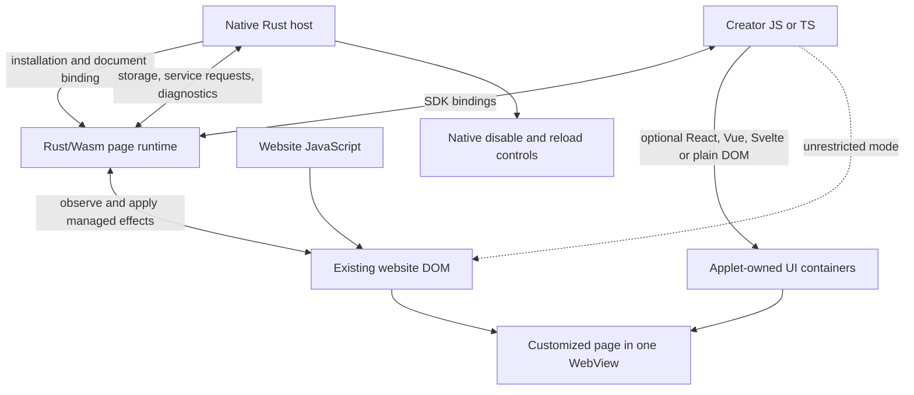

# Runtime architecture

Date: 27 October 2026. Proposed design, not implemented. [Set overview](README.md).

## 1. Execution and ownership

Start with one visible website WebView. Run the Genesis page runtime as Rust compiled to Wasm in a qualified injected execution world. Load the creator's bundled JavaScript into that world. Keep native coordination, storage, package activation and recovery in Rust behind a small Android integration layer.

The diagram's separate boxes do not imply separate renderer processes. The website, Wasm runtime and applet UI can share a renderer event loop. A blocking creator function can freeze the page.

| Component | Owns | Does not own |
| --- | --- | --- |
| Website | Its application state, original nodes, session and service behavior | Genesis notes and package revisions |
| Rust/Wasm page runtime | Target registry, observations, managed effects, scheduling, cleanup | Website private state or creator component internals |
| Creator code and chosen UI library | New UI contents, custom logic and applet state | Correctness of arbitrary changes to foreign components |
| Native Rust host | Installation identity, document binding, storage broker, lifecycle and recovery | Browser layout or individual React updates |
| Android adapter | WebView creation, callbacks, JNI forwarding and native control plumbing | Site-specific extraction or applet business logic |

Rust/Wasm uses browser DOM bindings rather than replacing the DOM implementation. Generated JavaScript bindings remain part of the build. [wasm-bindgen DOM example](https://wasm-bindgen.github.io/wasm-bindgen/examples/dom.html).

## 2. The revised meaning of source and result

There is one live DOM in the default mode. The website and Genesis both affect it. "Source" means website-owned nodes and selected observations; "result" means the presentation after customization. They are not two independently authoritative copies.

Genesis cannot always recover what the website would have rendered without customization. For example, if both parties change the same text node, the runtime cannot infer the website's intended text merely from the current value. A saved initial tree becomes stale as the website runs.

Prefer additive styles and new containers. If a projection needs an original field, avoid also rewriting that field. Where a creator chooses overlapping observation and mutation, define whether the API reads the current DOM or a previously observed value. Never label the latter a complete "true DOM".

A separate result document remains an optional later mode. It receives bounded observations and sends explicit source requests. It is useful for multi-source composition, but cannot receive live DOM pointers or automatically inherit the source's controls.

## 3. Runtime startup

1. Native Rust selects an installed applet revision and source URL. It creates a document binding and registers the supported bootstrap before navigation.
2. The injected bootstrap loads the Rust/Wasm module, SDK bindings and creator bundle. An explicit ready handshake binds them to the current document and installation.
3. The runtime activates the route scope, discovers targets and installs styles. New elements can arrive later; activation does not wait for a mythical final DOM.
4. It mounts new UI into empty Genesis-owned containers and exposes selected observations to that UI.
5. Navigation or package deactivation disposes the scope. Late messages and asynchronous completions from the old scope are ignored or returned as expired.

AndroidX exposes world-aware injection and messaging through `WebViewCompat`; provider support is feature-gated. Execution worlds belong to their WebView. These APIs are candidates, not a tested loader. [WebViewCompat](https://developer.android.com/reference/androidx/webkit/WebViewCompat), [feature detection](https://developer.android.com/reference/androidx/webkit/WebViewFeature), [execution-world binding](https://developer.android.com/reference/androidx/webkit/JavaScriptExecutionWorld).

Test Wasm compilation, creator bundle execution, stylesheet insertion and packaged asset loading separately. Successful script injection does not prove the other three. The applicable realm's CSP matters for Wasm compilation. Do not assume Chrome extension policy carries over to WebView. [CSP Wasm integration, editor's draft](https://w3c.github.io/webappsec-csp/#wasm-integration).

Use bundled code and assets for the installed prototype. A development server can accelerate authoring later, but must not be a hidden runtime dependency. If WebView cannot satisfy the bootstrap contract, compare GeckoView's built-in extension and native-messaging path before considering an engine fork. [GeckoView integration](https://firefox-source-docs.mozilla.org/mobile/android/geckoview/consumer/web-extensions.html).

WebView is the first experiment because it continues the existing Android hosting direction and exposes the required classes of injection APIs. This is a sequencing judgment, not a measured engine winner. GeckoView becomes a stronger candidate if built-in extension packaging removes substantial loader, asset or execution-world work. Compare the same fixture, creator bundle, original-player workflow and recovery cases in both hosts before changing engines. A desktop WXT/Plasmo prototype can evaluate authoring quickly, but does not settle that Android choice.

## 4. Managed effects

The runtime reconciles a set of requested effects, not a desired replacement of every website node.

Each effect records an installation revision, route scope, effect key, target definition, operation, current node binding and cleanup strategy. Effect keys must be stable across reevaluation so repeated activation does not create duplicate panels or listeners.

| Operation | Initial implementation | Compatibility limit |
| --- | --- | --- |
| Style a selected region | Owned stylesheet with explicit scope | Cascade conflicts and geometry-dependent behavior remain |
| Hide selected content | Scoped CSS rule or managed marker | Can affect loading, focus and accessibility; test the workflow |
| Add a component | Owned sibling/overlay host, optional ShadowRoot | Website may remove the host or anchor |
| Observe selected fields | Bounded immutable snapshots | Only the declared capture channels are covered |
| Replace one region | Mount replacement, then suppress original presentation | Source behavior and loading may need explicit integration |
| Set an existing attribute/property | Per-field ownership and conditional restoration | More invasive; both writers may disagree |
| Move an existing element | Explicit experimental operation | Requires site/provider qualification and a valid restore location |
| Arbitrary script | Ordinary DOM access with creator cleanup callback | No automatic complete undo or compatibility guarantee |

Choose style injection over repeated per-node style writes where possible. Do not promise that every rule wins the cascade. Verify the computed effect for important targets, and report conflicts instead of escalating every rule to `!important` indefinitely.

### Reconciliation cycle

1. Collect route, DOM and relevant state invalidations. Mark affected subscriptions dirty.
2. Resolve targets within declared roots. Validate expected cardinality and any creator guard before applying an operation.
3. Read only required fields. Publish a new snapshot when its content or status changes.
4. Compare requested effect keys and parameters with active effects. Apply necessary changes in a bounded batch.
5. Check targets and anchors again where writes can trigger synchronous callbacks. Record applied, missing, ambiguous, conflicted or expired status.
6. Dispose effects whose route, target or installation scope ended. Release node handles and observers.

Do not alternate whole-document reads and writes for each node. Coalesce invalidations, separate geometry reads from writes, and cap work per turn. MutationObserver reports selected tree/attribute/text changes; it is not a subscription to every property, computed style or pixel. Additional event/property/resize capture must be explicit. [DOM mutation model](https://dom.spec.whatwg.org/#interface-mutationobserver), [MutationObserver](https://developer.mozilla.org/en-US/docs/Web/API/MutationObserver), [ResizeObserver](https://developer.mozilla.org/en-US/docs/Web/API/ResizeObserver).

### Avoiding self-triggered loops

Exclude Genesis-owned UI interiors from ordinary website extraction. Keep an internal registry of owned nodes and writes. A DOM marker alone is not ownership authority. Compare desired and current values before writing.

Do not disconnect the observer around every write and assume nothing important happened: synchronous website callbacks can also mutate the page. Do not discard every mutation on a node Genesis previously touched. Treat expected writes as candidates for deduplication, then reevaluate the relevant state.

Even this cannot guarantee convergence when the website repeatedly undoes an effect. Start with a proposed conflict threshold of three reversals of the same managed field within one second. Suspend that effect, show a diagnostic and leave the website usable. Tune the threshold from fixtures; it is not a browser constant. Broader mutation bursts need an independent workload limit.

### Cleanup is conditional, not time travel

Removing an owned stylesheet or UI host is straightforward. Restoring an existing field is safe only when the runtime still owns the binding and the current value matches its last write. Otherwise preserve the current website value and report that cleanup could not fully restore the field. There is still an ambiguity if the website independently wrote the same value; a write ledger cannot establish perfect authorship.

Do not restore an entire initial DOM snapshot. It may delete current website state. Unrestricted scripts, event dispatch and server requests may be irreversible. When cleanup is incomplete, offer reload with the applet disabled. Reload reconstructs the website; it does not undo submissions or recover every unsaved edit.

## 5. Targets, navigation and resource lifetimes

Targets combine a selector, scope, cardinality and optional content guard. Named target modules are creator-editable. A semantic helper can be shared, but no central Genesis schema should be required to access a new field.

A node handle is scoped to a document and binding generation. A stable content URL or ID is a different identifier used for saved notes. Virtualized pages can reuse the same node for another record, so validate content identity before applying a delayed operation.

Start with the top-level document and one active applet per tab. Do not silently choose the first match when an operation expects exactly one. Missing and ambiguous targets are normal API states. Retrying discovery should be bounded and driven by relevant changes.

Keep distinct identities for the installed package revision, tab, document, route scope and known account/session changes. Same-document navigation can invalidate targets without creating a new document. Android's NavigationListener provides main-frame navigation information, but correct handling of the selected SPA routes still needs tests. [NavigationListener](https://developer.android.com/reference/androidx/webkit/NavigationListener).

Open shadow roots require explicit traversal. Closed roots and cross-origin frame contents are separate capabilities to qualify. Injecting a runtime in a child frame creates another context, not unrestricted top-frame access to it. Browser-owned UI is outside the website DOM.

## 6. State, data and operations

| State | Default location | Rule |
| --- | --- | --- |
| Website state | Original website runtime | Preserve original controls for its complex operations |
| Observed fields | Page runtime, optionally cached by native host | Bounded, versioned, explicitly partial |
| Temporary applet UI state | Creator framework | May reset on document replacement |
| Durable notes and settings | Native Rust storage broker | Namespaced by installation/profile, transactional writes |
| Creator service data | Creator endpoint plus applet cache | Explicit authentication, errors and sync semantics |

Do not use the website's localStorage as the default Genesis database. Even extension content-script web storage can refer to the page's storage. [Chrome storage contexts](https://developer.chrome.com/docs/extensions/develop/concepts/storage-and-cookies).

Offer ordinary browser `fetch` where policy permits and a separate host request API for declared creator endpoints. Content-script isolation alone does not grant cross-origin network access. A host request has its own credentials and cookie policy; it must not silently reuse website credentials or claim browser-fetch equivalence. [Chrome network contexts](https://developer.chrome.com/docs/extensions/develop/concepts/network-requests).

For source behavior, a direct user tap on the retained original control is preferable to forwarding a synthetic click. Creator controls may call qualified operations, but dispatching an event is not proof of a completed operation or of trusted user activation. [HTML user activation](https://html.spec.whatwg.org/multipage/interaction.html#tracking-user-activation).

Keep DOM querying, effect application and React updates local to the renderer. The native bridge carries installation/lifecycle messages, storage and network requests, diagnostics, and later cross-tab observations. It should not carry every mutation or React render.

Browser DOM work stays on its document thread. Android view operations stay on the Android UI thread. Native callbacks should enqueue bounded work and return promptly; database and network work must not block either UI loop. Scope every request to the installed revision and document binding, bound payload sizes, and reject expired replies. If native HTTP uses an async executor, keep it in the host service layer. Rust errors and panics must be handled at JNI/Wasm boundaries rather than unwinding through foreign callers.

## 7. Recovery and optional composition

Native controls must remain usable when the renderer hangs. Disable future injection, then reload or recreate the affected view. Feature-gated renderer termination can affect multiple WebViews; every affected view needs renderer-loss handling. [WebViewRenderProcess](https://developer.android.com/reference/androidx/webkit/WebViewRenderProcess).

A Rust scheduler can limit its own batches. It cannot preempt an arbitrary JavaScript infinite loop on the same event loop. Stronger isolation would require a different execution boundary and would restrict direct DOM access. Make that tradeoff explicit rather than claiming both unrestricted page access and complete fault isolation.

Later, an applet can open another source tab and receive bounded records from it. Each source retains its own document/session identity and freshness. Combining data is achievable; combining live DOM elements from several documents into one arbitrary layout is a separate problem. The default one-page model should not conceal this distinction.
