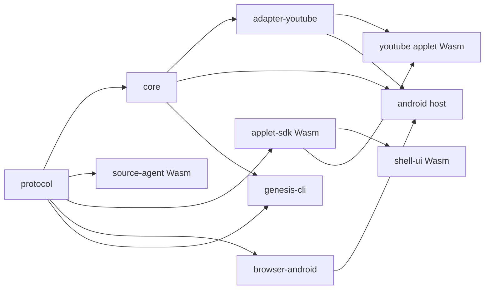

# Rust monorepo design for Genesis

Review update, 27 October 2026: use the [live customization roadmap](../live-dom-customization/05-implementation-roadmap.md) for the current implementation sequence. It starts with three Rust packages and a small TS workspace, preserves the original page and accepts JS/TS creator code. The ten-unit, Rust-only creator layout below is historical.

Date: 26 October 2026. Status: proposed architecture, not implemented or benchmarked. The [dependency inventory](2026-10-26-dependencies.md) records the proposed direct dependencies and upstream evidence.

New readers can start with the [runtime walkthrough](2026-10-26-runtime-walkthrough.md), which follows a video record and a user action through the complete system.

This proposal updates the earlier [React architecture](../source-dom-react/2026-10-26-architecture.md) for the requirement that Genesis DOM and UI control be written in Rust. It preserves the source/result separation and action protocol. It replaces Kotlin coordination and React rendering with Rust implementations.

## 1. Recommendation and language boundary

Use one Git repository, one Cargo workspace, Android System WebView for website execution, Rust/Wasm for in-document DOM access, and Leptos for Rust-authored applet UI. Build applets on a laptop and import their compiled artifacts onto the phone.

There are three execution contexts:

| Context | Rust compilation target | Responsibility |
| --- | --- | --- |
| Android host | `aarch64-linux-android` initially | Browser views, lifecycle, source coordination, mirror, packages and persistence |
| Source document | `wasm32-unknown-unknown` | DOM observation, live node references and source action execution |
| Result document | `wasm32-unknown-unknown` | Creator UI, SDK subscriptions and local presentation logic |

Rust native code cannot obtain a live browser DOM by linking `web-sys`. That API runs through browser bindings from Wasm. The wasm-bindgen project provides an actual [Rust DOM creation example](https://wasm-bindgen.github.io/wasm-bindgen/examples/dom.html).

This is Rust-authored behavior, not an entirely Rust runtime. Android WebView uses the installed browser engine. A stock Android host needs a JVM entry point and callback classes; use a small forwarding Java layer. wasm-bindgen generates JavaScript bindings and needs a loader. Website code still executes normally. Keep selectors, observation, transformations, routing, actions and UI state out of handwritten JavaScript and Java. The Java forwarding layer and generated JS must remain visible in the repository/build inventory.

If the rule means literally no Java, Kotlin or JavaScript artifacts, this WebView design does not satisfy it. Replacing those runtimes would be a different project. If creators should retain React, allow it as a deliberate applet-language exception and keep the Rust host/protocol unchanged. This proposal assumes Rust applets until that choice changes.

## 2. Repository layout

These are ten independently buildable first-party units, not ten Git repositories or ten services. Pure library units are small. Keep filesystem implementations and browser bindings out of them.

```text
genesis/
  Cargo.toml                      # workspace members, dependency versions, lints
  Cargo.lock                      # committed resolved Rust dependency graph
  rust-toolchain.toml             # pinned compiler and target list
  .cargo/config.toml              # target configuration, no machine-specific paths
  apps/
    android/                      # Rust cdylib, Android composition root
    shell-ui/                     # Rust/Wasm applet launcher and package status UI
  crates/
    protocol/                     # serializable contracts, no browser dependencies
    core/                         # pure Rust state machines and source mirror
    browser-android/              # Rust JNI adapter over Android WebView
    source-agent/                 # Rust/Wasm observer and interaction executor
    applet-sdk/                    # Rust/Wasm subscriptions, commands, optional UI helpers
  adapters/
    youtube/                      # pure Rust extraction from observed source records
  applets/
    youtube/                      # reference Rust/Wasm Leptos applet
  tools/
    genesis-cli/                  # Rust build/package/install/schema commands
  platform/
    android/
      app/                        # manifest, resources, forwarding Java classes
      gradle/                     # Gradle wrapper and version catalog
  fixtures/
    source-pages/                 # owned HTML + Rust/Wasm behavior for browser tests
    protocol/                     # snapshots, mutations, invalid and stale messages
    adapters/youtube/             # recorded, minimized source records
  schemas/                        # generated from protocol, checked for drift
  research/                       # proposals and evidence
  .github/workflows/              # separate native, Wasm and Android jobs
```

Generated Wasm, JS and APKs go in ignored build directories. Preserve source code and manifests in Git. Do not vendor Chromium or copy upstream projects into the repository at the start.

Cargo workspaces provide a shared lockfile, output directory and dependency declarations. Use a virtual root workspace with `resolver = "3"`, a common edition, and host-compatible `default-members`. Android and browser packages require separate target checks. [Cargo workspace reference](https://doc.rust-lang.org/cargo/reference/workspaces.html).

## 3. What each unit owns

| Unit | Owns | Must not own |
| --- | --- | --- |
| `apps/android` | Composition, controller loop, filesystem package store, activation, lifecycle orchestration | DOM selectors or applet layouts |
| `crates/browser-android` | Rust calls into WebView, view bounds/visibility, injection registration, bridge callbacks, UI-thread dispatch, renderer lifecycle | YouTube rules or applet state |
| `crates/protocol` | Message envelopes, source/node identity, snapshots, patches, commands, statuses, manifest types | JNI, Leptos, `web-sys`, filesystem access |
| `crates/core` | Mirror reducer, query interface, sequencing, session state, command state, package activation state machine | Live DOM handles, Android classes or actual file I/O |
| `crates/source-agent` | Browser DOM capture, node registry, ordered patch production, execution against current live nodes | Result DOM reconciliation or persistent package state |
| `adapters/youtube` | Extraction of video records from observed source trees, field coverage, site-specific recognition | Android calls, rendering, private service API clients |
| `crates/applet-sdk` | Result-side bridge client, immutable selected state, subscription cleanup, source commands, optional Leptos helpers | Direct control of source WebViews or shared cookies |
| `apps/shell-ui` | Applet list, source status, package selection and preview controls | Source coordination or another copy of package persistence |
| `applets/youtube` | User-customizable layouts, filtering and UI navigation over adapter records | Observation machinery or host lifecycle |
| `tools/genesis-cli` | Invoke Cargo, wasm-bindgen, Gradle and ADB; generate schemas; stage complete applet packages | A second implementation of runtime validation |

The YouTube adapter is shared maintained code. Applets reuse its record types, while the host invokes extraction over the source mirror. Its fixtures and adapter version travel together. Generic wire messages carry an adapter ID, schema version and serialized payload; the SDK decodes the payload into the adapter's Rust record types. Do not put YouTube fields into every core message.

The adapter and applet can initially be small crates. They are separate because changing a layout should not require changing extraction rules. Add a second adapter only after the first works. No plugin registry or dynamic native loading is required.

The first built-in native adapter changes with the host build. Creators who need their own extraction can request supported raw subtree records and transform them in their Rust/Wasm applet. That requires no native plugin installation. Extending source-agent capture or adding a new source operation is a separate host/agent capability change. Distinguish those changes from unrestricted Result DOM authoring.

## 4. Dependency direction and runtime path



An arrow means the recipient depends on the sender. Share validation in `core` rather than copying it into the CLI. Never let `core` acquire a dependency on a frontend or browser adapter.

```text
Website DOM
  -> source-agent Wasm
  -> WebView message bridge
  -> native Rust controller
  -> core source mirror
  -> adapter records or selected raw source records
  -> result WebView bridge
  -> applet-sdk
  -> creator Leptos UI

Creator interaction
  -> SDK command
  -> controller validation and source serialization
  -> source-agent lookup and execution
  -> observed result or explicit uncertainty
```

Keep the authoritative source mirror in native Rust. The result runtime receives bounded selected records and does not need to duplicate the full source tree. Offer raw subtree subscriptions through the same transport for advanced creators. This gives more freedom without allowing creators to bypass sequencing or retain native DOM objects.

Leptos owns the Result DOM. The website owns its Source DOM. Do not reconcile both through a shared virtual DOM. Leptos already handles rendering from Rust; Genesis builds the source mirror and command protocol. [Leptos browser integration](https://book.leptos.dev/web_sys.html).

## 5. Android embedding choice

Use Android WebView through a narrow Rust JNI adapter as the baseline. JNI permits Rust to call platform APIs, but does not itself implement Android callback subclasses. Keep a forwarding Activity, WebViewClient, WebChromeClient and bridge/dispatch classes under `platform/android`. Those classes pass events and return Rust decisions; product rules belong in Rust. Gradle remains the Android packaging system. [JNI crate](https://docs.rs/jni/latest/jni/).

Use AndroidX WebKit for document-start/world-aware injection where the actual installed provider supports it, message channels and local applet asset loading. Check `WebViewFeature` at runtime. A recent AndroidX library alone does not establish provider capability. [WebViewCompat API](https://developer.android.com/reference/androidx/webkit/WebViewCompat).

Wry is a useful alternative to writing some platform bindings. It is not a qualified shortcut for this design yet. Its documented child-WebView API supports macOS, Windows and Linux X11, and its Android setup generates Kotlin classes. Qualify Android multiple-view hosting, injection, renderer callbacks and source presentation before adopting it. If it passes, replace the internals of `browser-android`; do not add another competing browser owner. [Wry platform documentation](https://docs.rs/wry/latest/wry/).

Start with two WebViews in one Activity: one source and one result. The result view displays either the launcher document or the selected applet document. Avoid mounting independently compiled Leptos applications into the same root. The host can reveal the original source page for interactions the projection cannot support. Maintain a meaningful source viewport during the liveness experiment.

Two views do not imply two isolated renderer processes. Measure provider behavior and implement recovery without assuming a result crash leaves the source execution alive. Add multiple source views after this baseline works. Do not assume an offscreen or covered source behaves like a visible tab, particularly for media and lazy loading.

## 6. Threads and FFI boundaries

- WebView construction, layout, navigation and relevant API calls run on Android's UI thread. Rust sends requests to that thread; it does not call UI methods from a background worker.
- One native controller thread owns mutable source/session/mirror state. Use bounded standard-library channels initially. JNI callbacks enqueue work and return promptly. Synchronous platform callbacks need short, cached decisions rather than waiting on the controller while it waits on the UI thread.
- DOM capture and Leptos rendering run in their document event loops. Wasm does not move DOM work off the main thread or make infinite loops preemptible.
- Request interception can run on a different thread. Serve local resources from an immutable package snapshot and avoid calling UI APIs from the request callback. Android documents the asset loader interception entry point as a worker-thread operation. [Asset loader API](https://developer.android.com/reference/androidx/webkit/WebViewAssetLoader).
- Keep JNI references, JS values, DOM handles and callbacks inside their owning adapter. Cross contexts using owned serialized data, never pointers.
- A Wasm trap or renderer loss invalidates that agent's state. Reload, increment identity and recapture. Do not assume a recoverable Rust panic across an FFI boundary.

## 7. Contracts that protect correctness

Define these before a general creator API:

| Contract | Required behavior |
| --- | --- |
| Identity | Source instance, frame, document generation and node ID accompany references. JSON identifiers avoid unsafe JavaScript number precision. |
| Observation | Snapshot plus ordered mutation batches. Capture must buffer changes across initialization, not leave a gap before subscribing. |
| Resynchronization | Reject sequence gaps and old generations. Request a replacement snapshot. Never silently skip required operations. |
| Scope | Report observed subtree, loaded document or unknown coverage. Unloaded virtualized records are not available data. |
| Node reuse | Revalidate record identity when the site recycles an existing DOM node. |
| Commands | Validate target, generation and expected record. Serialize writes per source. Distinguish attempted, confirmed, rejected, needs-user and uncertain. |
| Navigation | Advance document identity for new documents. Detect same-document route changes independently. |
| Resources | Copying an image or media URL is not equivalent to transferring its authenticated resource or execution state. |
| Updates | Stage, validate, preview, activate and retain a known working package revision. Restore definitions after process death, not stale node handles. |

Rust prevents some invalid memory and type operations. It cannot prove that a selector still means "subscribe", that an extracted video is the intended one, or that an interface is useful. A successful compilation is one validation stage.

Use `web-sys` MutationObserver bindings for capture, plus the explicitly required property/event handling. MutationObserver does not cover all browser state. Closed shadow trees, cross-origin frames, CSSOM, canvas and live media remain separate qualification work. Do not introduce a full browser-state serialization promise for the prototype.

## 8. Source-agent loading is a feasibility gate

The result page is ours and can load our generated JS/Wasm. The source page is a third-party website. Treat these as different loading problems.

Register a minimal generated bootstrap through supported injection APIs, then instantiate the source-agent Wasm and attach the observer. Qualify execution-world behavior, byte/resource delivery, CSP and Wasm compilation restrictions, frame scope, timing and message availability on the target provider. Consider direct byte delivery through the host bridge and intercepted resource delivery as experiments, not proven methods.

Document-start registration does not imply asynchronous Wasm initialization completes before website scripts. Report the interval before the observer becomes ready. The prototype promises current observed state and subsequent updates, not a complete history from the first site instruction.

If source-agent Wasm cannot run on the target site/provider, stop before building the full framework. Choices then include a different supported embedding mechanism, a qualified engine change, or relaxing the Rust-only observer requirement. Do not quietly replace the source-agent with handwritten JavaScript while claiming the Rust requirement passed. [wasm-bindgen deployment targets and generated integration](https://wasm-bindgen.github.io/wasm-bindgen/reference/deployment.html).

## 9. Creator packages and local builds

```text
my-applet/
  genesis.toml
  Cargo.toml
  Cargo.lock
  src/lib.rs
  styles.css
  dist/
    index.html
    applet.js                     # generated binding/loader
    applet_bg.wasm
```

The manifest identifies the applet/revision, protocol version, SDK requirement, adapter requirements, required operations, entry asset and local state version. Start with exact supported version fields rather than inventing a dependency solver. CSS and static HTML remain presentation assets. Dynamic DOM/UI behavior is Rust.

This package example is a standalone creator project. The reference applet inside the monorepo uses the root workspace lockfile. The proposed CLI invokes `cargo build`, compatible `wasm-bindgen --target web`, Gradle and ADB. The source-agent can need a different generated loading mode after the injection experiment. No npm bundler is required for the strict Rust profile. CLI command names are proposals, not commands available today.

Serve immutable staged packages through WebViewAssetLoader using its reserved local asset domain. Define applet storage namespaces explicitly; different URL paths do not create different origins. Source-page Wasm loading remains the separate gate above. [Local asset hosting](https://developer.android.com/reference/androidx/webkit/WebViewAssetLoader).

Build editable Rust applet source on a laptop for the prototype. On-device runtime execution of compiled Wasm is different from on-device compilation of arbitrary Rust dependencies. Do not include a phone Rust toolchain in the first release. Persist package revisions and local settings as versioned files; a database and cloud backend are unnecessary for this prototype.

## 10. Implementation order and acceptance gates

All numbers below are proposed acceptance targets, not measured results. Record phone model, Android version, WebView provider/version and build mode for every result.

| Gate | Deliverable | Proposed acceptance evidence |
| --- | --- | --- |
| 1. Platform and Wasm | Minimal host, two views, source Rust/Wasm agent and result Rust/Wasm UI | Agent becomes ready on 20/20 scripted fixture navigations and 20/20 navigations of one selected real-site flow. Record failures, readiness latency and injection capabilities. |
| 2. Mirror correctness | Protocol, initial snapshot, patches and recovery | At least 10,000 generated mutation operations match a reference tree. Explicit cases cover insertion, move, removal, root replacement, stale generation and missing sequence. |
| 3. Interaction loop | Rust SDK command through host to live source, with observed completion | Deterministic fixture cases confirm correct targets and reject stale/recycled targets. An uncertain attempt never triggers an automatic duplicate action. |
| 4. Useful applet | One YouTube browsing flow, two creator layouts over the same records | Both layouts use the same adapter and action contract. Original source presentation handles qualified media interactions. Report exact supported pages and missing fields. |
| 5. Sustained updates | Bounded transport and observation | On a defined 1,000-node fixture at 100 mutations/second for 10 minutes, target p95 under 100 ms from host patch receipt to result render acknowledgement. Record queue peaks, CPU, memory and resyncs. This excludes capture delay and is not a whole-site benchmark. |
| 6. Recovery and packaging | Import, preview, activation, rollback and lifecycle recovery | Invalid package and startup failure retain the prior revision. Reload, Android background/resume and renderer-loss cases restore a valid state with fresh source identity. |

Build only the packages needed for each gate. The shell and polished CLI can follow the source-to-result loop. Do not spend the first sprint constructing all ten empty libraries.

Native checks cover `protocol`, `core`, the adapter and CLI. Browser tests use `wasm-bindgen-test` on Wasm packages. Android cross-checks use the actual NDK target; physical-device tests qualify WebView behavior. A desktop browser test cannot prove Android injection or lifecycle behavior.

## 11. Decisions to defer

Keep Chromium/Servo engine replacement, arbitrary live-widget relocation, multiple simultaneous sources, a marketplace, on-phone Rust compilation, a new UI language and a new virtual DOM outside the first prototype. Each can fit behind the contracts above after a demonstrated requirement.

Servo is worth tracking as an engine option, but Rust implementation and Android work do not establish compatibility with the first target site. Its own [Android progress report](https://servo.org/blog/2026/05/31/april-in-servo/) documents ongoing platform work. A Chromium fork also retains substantial non-Rust engine code. Neither choice removes the need for source identity, adapters or action confirmation.
