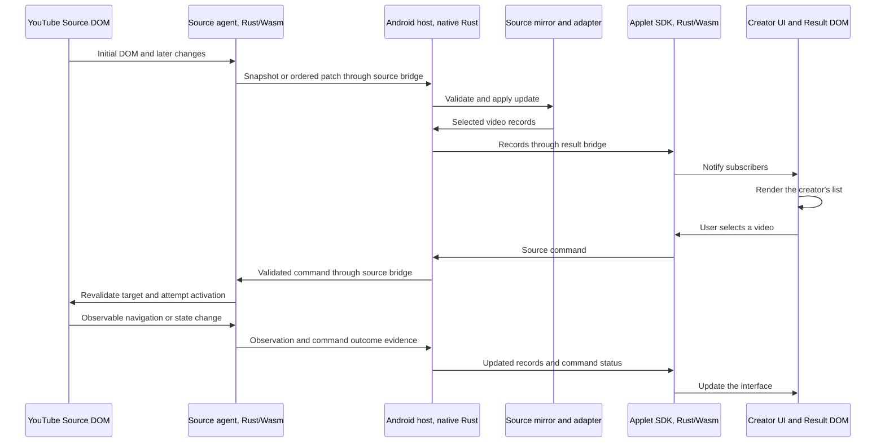

# How Genesis turns a website into a custom applet

Review update, 27 October 2026: the [live website customization document set](../live-dom-customization/README.md) replaces this default with incremental changes to the original page, a Rust runtime and JS/TS creator code. A native mirror and separate result document are optional. The walkthrough below preserves the original mirror-based example.

Date: 26 October 2026. Status: proposed runtime design. Genesis has not implemented or tested this flow yet. All message formats, identifiers and code examples below illustrate the intended contracts; they are not a finalized API or real YouTube DOM samples.

This document explains the architecture without requiring prior project context. The [monorepo design](2026-10-26-codebase-design.md) describes the code boundaries, and the [dependency inventory](2026-10-26-dependencies.md) describes the proposed tools and libraries.

## What Genesis does

Genesis is an Android application that runs websites in browser views and lets creators replace their presentation with custom interfaces called applets.

Consider a YouTube applet that displays videos from selected channels in a compact text list. YouTube still loads its website, manages its session and communicates with its servers. Genesis observes selected page content, exposes that content as data, and lets the creator render a different interface. When the user selects a video, Genesis sends an action back to the running website.

The initial design uses two Android WebViews. A WebView is a browser component embedded inside an Android application.

| View | Runs | Owns |
| --- | --- | --- |
| Source WebView | The original website and the Genesis source agent | The original website DOM, event handlers and live website execution |
| Result WebView | A locally installed creator applet | The custom interface DOM, layout and presentation state |

The DOM, or Document Object Model, is the browser's tree of document elements and text. Genesis calls the website's live tree the **Source DOM**, and the applet's live tree the **Result DOM**.

These are separate documents. Genesis transfers data and action requests between them. It does not move a website's live elements, event listeners or media objects into the applet.

## Where Rust runs

The design has three execution contexts:

| Context | Rust form | Main responsibility |
| --- | --- | --- |
| Android host | Native compiled Rust | Coordinate browser views, source state, messages and installed packages |
| Source document | Rust compiled to WebAssembly | Read the Source DOM, observe changes and execute supported actions |
| Result document | Rust compiled to WebAssembly | Render the applet and handle creator UI logic |

WebAssembly, abbreviated Wasm, lets the browser execute compiled Rust. The `wasm-bindgen` and `web-sys` bindings let that Rust code call browser APIs such as DOM queries and MutationObserver. Native Rust outside the document does not gain direct DOM access by importing those crates.

The host reaches Android platform APIs through JNI, the Java Native Interface. A small Java layer forwards Android lifecycle and browser callbacks to Rust. Browser-side Rust also needs generated JavaScript bindings and loading code. The requirement is that Genesis behavior and UI logic are written in Rust; this design still uses those platform adapters and the existing browser engine.

The source agent and the creator interface are separate Wasm builds. A single module does not automatically share memory or DOM references across both views.

## The complete loop



Each arrow crossing a WebView boundary carries a message. It is not a direct function call into another document's DOM.

## 1. The website produces the Source DOM

The host opens YouTube in a source WebView. The website loads content and creates its normal page.

For illustration, suppose a loaded card has the following structure. These element names and attributes are invented to explain the flow. A real adapter must be developed against observed website structures.

```html
<article data-channel="Forest Workshop">
  <a href="/watch?v=abc123">Building a tiny cabin</a>
</article>
```

The page contains a title, channel and video link. Its JavaScript also owns behavior that the HTML alone does not describe.

Only loaded, observed content is available to Genesis. If YouTube has not loaded another thousand videos, the source mirror does not contain them. Virtualized pages can also remove or reuse existing nodes as the user scrolls.

## 2. The source agent captures structured observations

The host arranges for Genesis's Rust/Wasm source agent to initialize inside the source document. Successful agent loading on the target Android WebView and real website is an implementation prerequisite, not an established capability of the prototype.

After initialization, the agent attaches observation machinery and captures a consistent initial snapshot of the selected subtree. It buffers or otherwise accounts for mutations during snapshot construction so there is no unexplained gap before incremental updates begin.

The agent maintains a local registry that associates live DOM nodes with IDs. A simplified snapshot could be:

```json
{
  "type": "source_snapshot",
  "protocol_version": 1,
  "source_instance": "youtube-runtime-a",
  "frame_id": "main",
  "document_generation": 7,
  "sequence": "42",
  "coverage": "observed-subtree",
  "root_id": "100",
  "nodes": [
    {
      "id": "100",
      "kind": "element",
      "tag": "article",
      "attributes": { "data-channel": "Forest Workshop" },
      "children": ["105"]
    },
    {
      "id": "105",
      "kind": "element",
      "tag": "a",
      "attributes": { "href": "/watch?v=abc123" },
      "children": ["106"]
    },
    {
      "id": "106",
      "kind": "text",
      "text": "Building a tiny cabin"
    }
  ]
}
```

The sequence is a string in this example so a large integer does not lose precision when it passes through JavaScript. The final Rust protocol must define serialization rules consistently.

The snapshot contains copied values and node identities. The source agent retains the live node handles inside the source document. It never serializes a Rust pointer or a browser DOM object for use in the host.

MutationObserver supplies DOM mutation notifications. Other required state, such as some input properties or route changes, needs explicit handling. Observing a document does not automatically capture every kind of browser state.

## 3. The WebView bridge transports the observation

The agent serializes the message and sends it through the source WebView's messaging channel.

The Android browser adapter receives the callback and forwards the message to the native Rust controller. It preserves the identity of the originating view. The controller compares that context with the message rather than trusting a claimed source ID alone.

The bridge transports bytes or serialized values. It does not interpret YouTube cards, filter channels or render the interface. There is also a result-side bridge for delivering host messages to the applet SDK and returning applet commands.

Messages need explicit size limits and bounded queues. Repeatedly copying a large document into both views would consume CPU and memory even when the code doing the copying is written in Rust.

## 4. The native controller validates and routes the message

The controller owns source lifecycle and the ordering of accepted updates. Before applying the snapshot, it checks the protocol version, message shape and originating source context.

The identity fields have different purposes:

| Field | Purpose |
| --- | --- |
| Source instance | Distinguishes one running source from a replacement created after renderer loss or recreation |
| Frame ID | Distinguishes documents inside the same source view |
| Document generation | Invalidates references when that frame loads a new document |
| Sequence | Establishes update order within that document |
| Node ID | Identifies a registered node within that document context |

A node ID alone is insufficient. Node `105` in another document could refer to an unrelated element.

Android UI calls must execute on the appropriate Android UI thread. The native controller can maintain its state on a separate Rust thread, while the platform adapter dispatches view operations to the UI thread. DOM operations remain in the source document's browser event loop.

## 5. The source mirror stores structure; the adapter extracts meaning

The controller applies the accepted snapshot to the source mirror. The mirror is a Rust data structure in native memory. It stores observed nodes and their relationships, plus the accepted document identity and sequence.

It is not another live DOM. It has no browser layout engine, original JavaScript event handlers or media playback objects.

The YouTube adapter queries that mirror and recognizes video cards. For the example above, it produces a domain record:

```json
{
  "video_id": "abc123",
  "title": "Building a tiny cabin",
  "channel": "Forest Workshop",
  "source_ref": {
    "source_instance": "youtube-runtime-a",
    "frame_id": "main",
    "document_generation": 7,
    "node_id": "105"
  }
}
```

The video ID identifies content. The source reference identifies a current interaction target. Keeping both allows Genesis to check whether a reused DOM node still represents the expected video.

The adapter is where site-specific extraction rules belong. If the website changes its structure, this adapter may need an update. A creator changing list spacing should not have to modify those rules.

Adapter output also reports coverage, freshness and missing fields. An empty list after a valid extraction is different from a failed extraction. Creators need that distinction to display useful loading and error states.

## 6. The applet SDK exposes selected records

The applet software development kit, or SDK, is the library creators use to communicate with Genesis. The host sends selected video records through the result bridge. The SDK decodes them into typed Rust values and updates the applet's subscriptions.

The SDK provides the creator with:

- A subscription to video records or supported raw source subtrees.
- Source loading, freshness and failure status.
- Commands that refer back to source targets.
- Command results and subscription cleanup.

This hides transport and synchronization details from normal layout code. It does not hide incomplete data or uncertain actions.

The built-in adapter runs against the native mirror in this proposal. A creator can instead transform selected raw source records inside their applet. That allows custom extraction without installing a native plugin, subject to the fields and operations the source agent exposes.

## 7. The creator's Rust UI renders the Result DOM

The creator writes a Rust UI using Leptos. Conceptually, the applet:

1. Subscribes to the selected source's video records.
2. Filters them by the user's chosen channels.
3. Renders each remaining video as a compact row.
4. Associates the row's Open control with its source reference and video ID.

The result could look like this:

```text
My selected channels

Building a tiny cabin
Forest Workshop                         [Open]
```

Leptos creates the actual Result DOM elements and updates them when subscribed state changes. The creator controls the layout and local presentation behavior. The website continues to own the Source DOM.

Creator preferences, such as selected channels, are separate from website state. A source refresh should not erase those preferences.

## 8. A user action returns to the running source

When the user selects Open, the SDK sends an action request. A simplified command is:

```json
{
  "type": "source_command",
  "command_id": "command-18",
  "operation": "activate",
  "target": {
    "source_instance": "youtube-runtime-a",
    "frame_id": "main",
    "document_generation": 7,
    "node_id": "105"
  },
  "expected_record_key": "video:abc123"
}
```

The host validates the command and serializes conflicting actions for that source. The agent then resolves node `105` to a live element and rechecks that it still represents video `abc123` before attempting the supported activation.

The second check matters because the DOM can change after the host validates the request. The website might have removed the node or reused it for another video.

A synthetic activation does not automatically have the same browser privileges as a direct user interaction inside the source view. If the operation needs genuine source interaction or is otherwise unsupported, Genesis reports `needs-user` and can reveal the original source page.

After an activation attempt, Genesis looks for the expected observable result, such as navigation to the selected video's watch route. Observing that route confirms navigation, not successful video playback.

| Outcome | Meaning |
| --- | --- |
| Attempted | The executor dispatched an operation |
| Confirmed | Genesis observed the defined result |
| Rejected | The target or request was invalid before execution |
| Needs-user | The user must complete the interaction in the source view |
| Uncertain | The attempt may have executed, but Genesis cannot establish its outcome |

An uncertain command must not automatically become another submission. That rule matters for actions with side effects as well as navigation.

## How ongoing changes reach the interface

Suppose the title's text node changes after the initial snapshot. The agent can send a patch instead of the whole tree:

```json
{
  "type": "source_patch",
  "source_instance": "youtube-runtime-a",
  "frame_id": "main",
  "document_generation": 7,
  "from_sequence": "42",
  "to_sequence": "43",
  "operations": [
    {
      "operation": "set_text",
      "node_id": "106",
      "text": "Building a tiny cabin, part two"
    }
  ]
}
```

If the mirror is at sequence `42`, the controller applies the patch atomically and advances it to `43`. The adapter recomputes affected records, the SDK publishes their changes, and Leptos updates the relevant row.

If the mirror is at sequence `40`, applying this patch would leave missing changes unexplained. The controller marks the state as unsynchronized and requests a new snapshot. It does not silently treat the partial tree as current.

New-document navigation invalidates the previous document generation. Same-document navigation, such as a website changing routes without reloading, requires route and record updates even if the generation stays unchanged.

## Failure and resource boundaries

| Situation | Required response |
| --- | --- |
| A sequence is missing | Stop treating the mirror as current and request a snapshot |
| A target was removed or recycled | Reject or refresh the target instead of activating the wrong record |
| The adapter no longer recognizes the page | Report extraction failure, rather than presenting a misleading successful empty result |
| A source renderer is lost | Recreate the source, assign a new instance identity and recapture |
| An applet update fails | Retain or restore the previous working package revision |
| A source action cannot be reproduced | Explain the status and offer original-source interaction |

Two WebViews do not establish separate renderer processes. A failure may affect both, so recovery cannot assume the source always survives an applet crash.

Images, canvas, authenticated resources and video are separate from text-record extraction. Copying a URL does not necessarily make its resource usable in the result document. The first media path should retain the original source presentation until a specific alternative is qualified.

Multiple source tabs repeat this loop with separate identities, mirrors and queues. A combined applet can render records from several sources, but those records have different observation times. Genesis does not obtain an atomic snapshot across independent websites.

## Code ownership

| Part of the flow | Proposed code location |
| --- | --- |
| Browser lifecycle and coordination | `apps/android` |
| Android WebView bridge and view operations | `crates/browser-android` and forwarding classes in `platform/android` |
| Message and identity definitions | `crates/protocol` |
| Source-agent capture and live execution | `crates/source-agent` |
| Mirror updates and command state | `crates/core` |
| Video recognition and extraction | `adapters/youtube` |
| Result-side subscriptions and commands | `crates/applet-sdk` |
| Creator's reference interface | `applets/youtube` |

The [monorepo design](2026-10-26-codebase-design.md) also covers package tooling and the launcher. Its first implementation gate is loading the Rust/Wasm source agent on a real target website, then completing one observed-change and action round trip on an Android device.

## Technical references

- [Rust DOM access through web-sys](https://wasm-bindgen.github.io/wasm-bindgen/examples/dom.html) demonstrates browser DOM manipulation from Rust/Wasm.
- [wasm-bindgen deployment](https://wasm-bindgen.github.io/wasm-bindgen/reference/deployment.html) explains the generated browser integration and output targets.
- [Android WebViewCompat](https://developer.android.com/reference/androidx/webkit/WebViewCompat) documents injection and messaging APIs. Provider capabilities still need runtime checks.
- [Leptos browser integration](https://book.leptos.dev/web_sys.html) explains how Rust UI code interacts with browser APIs.

These references establish underlying APIs. They do not establish that Genesis's full source-agent loading, synchronization or website compatibility has been implemented.
