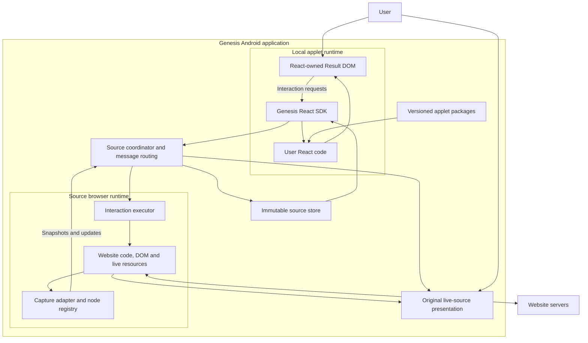

# Proposed Genesis projection architecture

Current implementation guidance: [live website customization](../live-dom-customization/README.md) uses same-document customization by default, a Rust runtime and JS/TS creator code. This document preserves the earlier separate-document React/Kotlin proposal.

Date: 26 October 2026, Asia/Kolkata. Status: proposed design, no implementation. [Research and sources](2026-10-26-research.md) explains the evidence. [Roadmap](2026-10-26-roadmap.md) defines the experiment sequence.

## 1. Runtime ownership

Keep the original website alive in an app-owned source WebView. Run user React in a separately owned Result DOM. Android owns the registry, source selection, navigation, work serialization and source-view presentation.



The store can live in the applet JavaScript runtime; Android need not duplicate the complete tree in Kotlin. Android routes bounded messages and retains source identity and lifecycle ownership. A small metadata/state store in Kotlin is sufficient initially.

A same-document variant can remove the cross-WebView transport for some operations. Preserve the same source/action interfaces so this choice does not spread into creator code.

## 2. Three ownership rules

1. The website owns source nodes. Observation does not invite React to reconcile those nodes.
2. User React owns its Result DOM. Source patches update a store, not arbitrary nodes inside the React root.
3. A live source component is presented as original browser content. It is never represented as a supposedly equivalent cloned DOM subtree.

React portals do not change these rules. They render React-owned children into another container; they are not a way to move an existing remote website widget across documents with its original runtime intact.

## 3. Capture and source mirrors

Begin with a qualified source subtree and selected properties. Compare a small observer with rrweb capture. A whole-page DOM API may remain available to advanced applet authors, but do not serialize all computed styles and geometry on every change by default.

The initial observer must cover:

- An initial snapshot plus ordered insert, remove, move, text and attribute updates.
- Current input/selection properties where required, collected through explicit events or qualified property observation.
- Source navigation, same-document route changes and frame creation/destruction.
- New document generations and explicit full resynchronization.
- Root replacement, delayed content, virtualized row recycling and missing fields.
- Separate status for loading, ready, incomplete, needs-user, stale, unsupported and failed.

A MutationObserver alone does not catch every input.value assignment or stylesheet API change. Start with the data requirements of the first applet. Do not claim a generic complete browser-state stream.

Capture open shadow trees explicitly where needed. Closed shadow trees, cross-origin frames and canvas content have separate compatibility limits. A normal document query is not a universal traversal across those boundaries. Maintain source viewport geometry during the liveness experiment; display:none is not a transparent way to stop painting while keeping all source behavior unchanged.

Install source listeners before navigation using qualified AndroidX APIs. Early registration avoids relying solely on a post-load rewrite. Document-start code should attach minimal machinery and wait for required DOM states rather than assume the body exists.

Snapshots and patches must agree on a synchronization point. Buffer mutations during the initial capture or use a capture library whose ordering you qualify. Do not publish a snapshot with an unexplained gap before its first patch.

Use weak references or document-scoped registries where appropriate, and remove deleted nodes and subscriptions so a node mirror does not retain every element ever seen.

## 4. Proposed contracts

The following TypeScript is a contract sketch, not a claim that these Genesis APIs exist. The chosen capture library's wire format must be adapted explicitly. Its internal node IDs must not be mistaken for cross-navigation business identifiers.

```ts
type SourceId = string;
type DocumentGeneration = number;
type NodeId = string;

type SourceRef = {
  sourceId: SourceId;
  frameId: string;
  documentGeneration: DocumentGeneration;
  nodeId: NodeId;
};

type NodeRecord = {
  id: NodeId;
  parentId: NodeId | null;
  kind: 'element' | 'text';
  tag?: string;
  text?: string;
  attributes?: Record<string, string>;
  properties?: Record<string, string | number | boolean | null>;
  childIds: NodeId[];
};

type SourceSnapshot = {
  protocolVersion: 1;
  sourceId: SourceId;
  frameId: string;
  documentGeneration: DocumentGeneration;
  accountRevision: number;
  sequence: number;
  capturedAt: number;
  rootId: NodeId;
  nodes: NodeRecord[];
  coverage: 'observed-subtree' | 'loaded-document' | 'unknown';
};

type SourcePatch = {
  sourceId: SourceId;
  frameId: string;
  documentGeneration: DocumentGeneration;
  accountRevision: number;
  fromSequence: number;
  toSequence: number;
  operations: PatchOperation[];
};
```

PatchOperation needs defined insert/remove/move/text/attribute/property semantics, including child ordering and subtree insertion. Freeze examples and malformed cases before transport implementation. Multi-frame snapshots are separate frame records with an explicit frame hierarchy, not one ordinary same-origin document.

An account revision changes on known session invalidation. Unknown account identity remains unknown; DOM observation cannot detect every server-side account change.

Use an atomic store update per patch batch. Reject another document generation. On sequence mismatch, stop applying patches and request a snapshot. Never silently continue from a partial tree. Backpressure must retain essential ordered operations or replace them with a new snapshot; arbitrary dropping corrupts the mirror.

Queries should support selecting a bounded subtree or data projection and subscribing to relevant changes. Cache snapshots so React useSyncExternalStore can return stable immutable values until the selected state changes. Do not recreate a complete snapshot on every render.

### Interaction requests

```ts
type SourceCommand = {
  id: string;
  target: SourceRef;
  accountRevision: number;
  operation: 'activate' | 'setText' | 'scroll' | 'navigate';
  arguments: Record<string, unknown>;
  expectedRecordKey?: string;
};

type CommandResult = {
  id: string;
  status: 'confirmed' | 'rejected' | 'needs-user' | 'uncertain';
  sourceSequence?: number;
  reason?: string;
};
```

These operations need per-capability implementation. setText must not be assumed to behave identically for a plain input, a controlled React field and contenteditable. Start with navigation and source activation. Keep complex text editing in the original page until separately qualified.

A result-side element is not required to preserve source coordinates. For a card click, resolve the source reference or domain key and invoke the corresponding operation in the source. Coordinate replay is a fallback with known limitations, not the primary binding.

Recheck that a node still represents the expected record. A virtualized list can reuse the same node for a different item without a new document generation. If identity is uncertain, re-observe or refuse. One writer per source prevents competing applets from navigating the same runtime simultaneously.

A click callback establishes an attempt. Confirmation requires observing the expected source change. Do not turn a timeout after dispatch into an automatic duplicate submission. The source runtime remains authoritative for service results.

## 5. Raw trees and useful records

Offer a low-level source-tree interface for advanced authors. Also provide adapters that produce stable domain records, such as video cards, without locking the frontend into a native widget catalog.

For example, a qualified adapter could emit title, source link, content key and source reference. It can only include fields actually observed. A semantic adapter remains shared maintained code; creators can change list, grid, board and navigation behavior without duplicating selectors.

Proposed creator example:

```tsx
function VideoBrowser() {
  const videos = useSourceProjection('youtube', selectLoadedVideoCards);

  return (
    <main>
      <h1>My videos</h1>
      <div className="video-grid">
        {videos.items.map(video => (
          <button
            key={video.contentKey}
            onClick={() => sources.activate(video.sourceRef)}
          >
            {video.title}
          </button>
        ))}
      </div>
      <SourceStatus coverage={videos.coverage} age={videos.age} />
    </main>
  );
}
```

useSourceProjection, selectLoadedVideoCards, sources and SourceStatus are proposed SDK functions/components. They need implementation. This snippet deliberately makes no claim about current YouTube selectors, thumbnail transfer or completed service support.

## 6. Resources and live components

Data projection and resource reuse are separate requirements. Text can cross as data. A source-authenticated image, canvas bitmap, blob URL, embedded frame or media buffer cannot be assumed to work by copying its string reference into the result page.

Initially support text and validated links. Qualify image delivery separately: browser-mediated extraction, an allowed public resource URL, or original-source display are different paths. Do not silently add service API calls to fill missing data. Shared cookies between some host views do not erase origin and media ownership rules.

For YouTube, keep the original player's execution and presentation coupled until a specific reuse method passes. Model a live component as a host presentation request, not as a serialized video element.

```ts
type LiveSourcePresentation = {
  sourceId: SourceId;
  mode: 'original-page' | 'qualified-region';
  regionId?: string;
};
```

The first implementation supports original-page. qualified-region is conditional on an actual provider/site experiment. A rectangle can contain a real source view; it does not grant arbitrary CSS-level composition of cross-document live nodes. Fullscreen handling also requires host callbacks, focus restoration and Android Back behavior.

If arbitrary live-widget relocation is indispensable, this architecture names it as a separate required capability. Falling back to the original page does not claim to have satisfied that stronger requirement.

## 7. Local React codebase and updates

An applet package should contain editable source plus compiled assets:

```text
my-applet/
  genesis.json
  package.json
  package-lock.json
  src/
    App.tsx
    styles.css
    projections.ts
  dist/
    index.html
    assets/
```

Suggested manifest fields: applet ID, revision, SDK/schema requirements, compiled entry point, source bindings, required operations, local state version and authoring metadata. Shared site adapters are versioned independently. Keep source code and local app state separate from the original website session.

Build on a laptop first with Vite. Import the complete source and build into app-private versioned storage. The accepted applet runs without a laptop. Serving static assets under a stable local HTTP-style origin is a browser-loading problem already addressed by WebViewAssetLoader; define an applet-specific origin policy before implementing storage assumptions.

Update workflow: edit, compile, stage, preview, activate, and revert. Activation replaces the React frontend revision atomically, while preserving source tabs when compatible. A syntax error or frontend crash must not destroy the source runtime. If validation or startup fails, restore the last working frontend or show the original page.

Laptop development HMR is optional. On-phone code editing is a later authoring feature. esbuild-wasm can help compile in a browser context, but does not itself supply an npm registry, virtual filesystem, package resolver or complete Node environment. Prebundled dependencies are the smaller initial phone-authoring design.

## 8. Runtime state and recovery

Track these lifetimes separately:

| State | Lifetime and recovery |
| --- | --- |
| React source/build revision | Persistent, atomic rollback |
| Applet local settings | Persistent versioned store |
| Website session | Owned by the source browser profile; qualification required |
| Node identity and mirror | Valid only for the current source/frame/document generation |
| UI drafts | Explicit recovery policy, never overwrite from a source refresh |
| Pending source operation | Attempt/confirmed/uncertain state; no blind replay after process death |

On renderer loss, replace the source WebView, invalidate references and obtain fresh observations. On ordinary source navigation, advance the affected generation and keep the custom interface alive with loading status. On same-document navigation, reevaluate bindings and record identity even if the document generation remains unchanged.

When another Android app becomes active or the screen locks, the initial contract makes no ongoing-execution promise. Original offscreen content inside a visible Genesis app is a separate measured state. Saving an applet restores definitions; it does not preserve every source execution object.

Multiple sources have separate timestamps and partial-failure states. They cannot provide a single atomic cross-service snapshot. Multiple applets that share a source need serialized navigation ownership; a duplicate source runtime is another resource and account decision.

## 9. What Genesis must build

Reuse browser execution, DOM observation mechanisms, React reconciliation, frontend bundling and optional capture libraries. Genesis-specific work is the source/result protocol, identity and resynchronization, operation binding, live-source presentation, applet packaging and authoring feedback.

The decisive API is a controllable live source with a stable observation contract, not an unrestricted HTML string replacement. A fork can later implement the same source interface if standard WebView capabilities prove insufficient.
